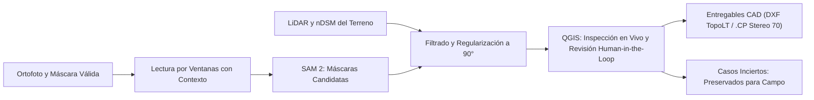

<p align="center">
  <a href="README.md">🇬🇧 English</a> &nbsp;•&nbsp;
  <a href="README.ro.md">🇷🇴 Română</a> &nbsp;•&nbsp;
  <a href="README.es.md"><b>🇪🇸 Español</b></a>
</p>

<p align="center">
  
  
  
  
  
  
</p>

# StratumRO

**La plataforma del topógrafo y geodesta: datos geoespaciales, algoritmos de regularización geométrica e inteligencia artificial orquestados en un flujo de trabajo abierto y determinista.**

StratumRO funciona como un **centro integrado de herramientas basado en protocolos abiertos (incluyendo MCP – Model Context Protocol)**, diseñado para permitir a asistentes de IA e ingenieros geomáticos orquestar el software establecido de geodesia e ingeniería: **QGIS Desktop**, **motores CAD** (AutoCAD, Civil 3D, TopoLT), modelos de visión por computador (**SAM 2**), análisis de nubes de puntos LiDAR (nDSM) y geometría computacional.

> [!IMPORTANT]
> **QGIS como la Fase 1 Operativa Activa**: Aunque StratumRO está concebido como una plataforma multi-software extensible capaz de comunicarse con múltiples entornos de ingeniería (entornos CAD, procesadores por lotes CLI y una futura aplicación de escritorio independiente), **actualmente operamos y desarrollamos directamente dentro de QGIS Desktop**. QGIS constituye nuestra estación de trabajo principal para la inspección visual, la verificación en el lienzo en vivo y la revisión asistida por humanos (**Human-in-the-Loop**). La automatización genera y regulariza propuestas de geometrías candidatas hasta la decisión técnica y la firma profesional del topógrafo autorizado.
>
> 📖 Para una guía detallada del entorno operativo en QGIS, consulte: [**StratumRO en QGIS (Guía Operativa de la Fase 1)**](docs/QGIS_WORKFLOW.md).

---

## Resumen Ejecutivo

- **Dominio Activo**: **El catastro constituye la prioridad inmediata** (reconstitución, separación y regularización ortogonal de envolventes de edificios en el sistema métrico oficial Stereo 70 EPSG:3844, conforme a la normativa de la ANCPI), junto con módulos de análisis urbanístico y PUG.
- **Ecosistema Multi-Software**:
  - **QGIS Desktop (Fase 1)**: Estación de inspección visual, control del lienzo mediante socket bridge MCP local (puerto 9876) y proyecto maestro de revisión [`inspectie_corectii.qgs`](workspace/reviews/body_recovery_20261013/inspectie_corectii.qgs).
  - **Entornos CAD**: Exportación nativa abierta a formato **DXF** (capas y bloques conformes con TopoLT y la Orden ANCPI 600/2023) y tablas de coordenadas catastrales `.cp`.
  - **IA y Visión por Computador**: Máscaras candidatas con Meta SAM 2 guiadas por alturas relativas del terreno derivadas de LiDAR nDSM.
- **Rigor Geodésico**: Sin certificaciones automáticas ficticias. Todos los cálculos son estrictamente métricos en el sistema de referencia nacional Stereo 70.

[Flujo y Arquitectura](#cómo-funciona-stratumro) · [Evidencia Visual](#resultados-visuales-del-proyecto) · [Fórmulas Matemáticas](#cómo-se-miden-los-resultados) · [Inicio Rápido](#cómo-explorar-el-proyecto) · [Documentación](#documentación-y-recursos) · [Guía para Agentes IA](AGENTS.md)


**Estado: Desarrollo y evaluación experimental.** La muestra validada en Cluj-Napoca abarca **~0,420 km²** (67 ventanas con datos RGB válidos de 144 planificadas). El sistema no declara una precisión o exhaustividad no verificadas a escala de todo el municipio. Los valores como `ADMIS` en el código corresponden a compuertas de pruebas internas; ninguna geometría generada sustituye la validación oficial sin la aprobación de un profesional competente. Consulte [Estado Verificado y Limitaciones](docs/PROJECT_STATE.md).

---

## Cómo funciona StratumRO

Cualquier proyecto comienza con un Área de Interés (AOI), los datos sensoriales disponibles y el entregable legal requerido. StratumRO reutiliza herramientas GIS consolidadas y mantiene la trazabilidad absoluta entre la fuente de datos, el algoritmo computacional y la verificación humana.



El diagrama describe el flujo experimental de cubiertas. **SAM 2 propone segmentos de imagen**; la identificación del edificio, la separación de cuerpos constructivos y la aceptación geométrica exigen verificaciones adicionales. LiDAR aporta la cota relativa (nDSM); la ausencia de puntos en la clase ASPRS 6 (edificación) no descarta automáticamente una estructura. Consulte [Meta SAM 2 Oficial](https://github.com/facebookresearch/sam2) y la [Implementación Regional](stratum_ro/regional_roofs.py).

| Etapa del Pipeline | Objetivo | Implementación Existente |
|---|---|---|
| **Preparación de Datos** | CRS Stereo 70, teselado con solape, máscara de píxeles válidos | [Raster core](stratum_ro/core/raster/reader.py), `OrthoMosaic` en [regional_roofs.py](stratum_ro/regional_roofs.py) |
| **Propuesta de Máscaras** | Candidatos morfológicos en RGB, soporte opcional nDSM | [Flujo de cubiertas](stratum_ro/cadastral_roof_workflow.py) |
| **Geometría y Regularización** | Ajuste rectangular, esquinas ortogonales a 90°, métricas | [Vectorizador](stratum_ro/vectorizer.py), [Métricas](stratum_ro/core/geometry/metrics.py) |
| **Revisión en QGIS (Fase 1)** | Proyecto maestro compartido, identificadores estables, sincronización | [Guía QGIS](docs/QGIS_WORKFLOW.md), [Proyecto Compartido](workspace/reviews/body_recovery_20261013/inspectie_corectii.qgs) |
| **Entrega CAD/GIS** | Capas TopoLT, tablas de puntos `.cp`, paquetes GeoPackage | [Catastro](stratum_ro/cadastral_product.py), [PUG](stratum_ro/pug_product.py), [Generador Dual](tools/build_dual_products.py) |
| **Orquestación y Servicio** | Servicio API local y puente de conexión de herramientas | [Servicio de la Plataforma](stratum_ro/api/service.py), [Lanzador](start_platform.py) |

---

## Resultados visuales del proyecto

### T10: Corrección local y separación de cuerpos constructivos


A la izquierda se observa el contorno anterior incompleto; a la derecha, el rectángulo rectificado del tejado cerámico. El cuerpo anexo bajo, de color gris al oeste, se conserva como un objeto físico independiente. La captura se tomó antes del veredicto final y conserva la etiqueta histórica `PENDING_OWNER_REVIEW`; **la aceptación posterior del propietario está registrada en el [Informe T10](workspace/reviews/t10_antigravity_20261013/t10_report.json)**. Es un caso validado visualmente de forma local sin afirmar una precisión global sobre toda el área.

### Escaneo regional: procesamiento automático por ventanas


La vista muestra propuestas y categorías de revisión superpuestas a la ortofotografía. Los contornos de color son **observaciones experimentales**, incluidos casos ambiguos y bordes no resueltos. La [Selección Activa](workspace/reviews/regional_roofs_20261017/CURRENT_REVIEW.json) define el paquete GIS exacto utilizado.


| Medición | Valor Medido e Interpretación |
|---|---|
| Ventanas Planificadas | **144**: 67 procesadas con RGB válido, 77 sin datos válidos en el núcleo |
| Área Válida del Núcleo | **419.681 m²**, aprox. **0,420 km²**; no representa la totalidad del municipio |
| Observaciones Desduplicadas | **2.081**, clasificadas en 380 candidatos de cubierta, 644 ópticamente inciertas, 1.057 probable vegetación |
| Tiempo de Ejecución del Escaneo | **443,4 s** en el informe de ejecución; excluye inicialización y empaquetado |
| Precisión / Cobertura | **No evaluadas independientemente**; el número de observaciones no equivale a edificios certificados |

### Inspección Catastral Ultra-Detalle a Escala 1:150 y Regularización Equilibrada


La transición desde la escala general de vuelo (~1:1200) a la **Escala Real de Ejecución Topográfica 1:150** (ventana de visualización de 44 m × 25 m, resolución en suelo de 1 px = 3,9 cm) permitió el inventario sistemático de **9 categorías de defectos (214 anomalías)** en toda el área de 1,05 km × 1,05 km.

- **Invariante Catastral: Precisión > Número Mínimo de Nodos**: Se eliminaron los umbrales de sobre-simplificación (`hull_ratio >= 0.78`) que colapsaban alas arquitectónicas en cajas de 4 nodos. El motor `fit_balanced_orthogonal_roof` restauró **75 estructuras articuladas (alas en L, U, T, porches y ábsides)** con 6–14 nodos a 90° Manhattan, respetando estrictamente aleros y cumbreras.
- **Eliminación de Espículas y Dientes de Sierra**: La exigencia de una longitud mínima de arista ($\ge 1,20\text{ m}$) y la supresión de esquinas agudas parásitas ($< 75^\circ$) garantiza geometrías catastrales limpias y profesionales con un **100,0% de ortogonalidad a 90°**.
- **Entregable Consolidado (`b_proposals_cleaned.gpkg`)**: 195 cuerpos 1CC activos validados (-0,40m de retranqueo), 0 espículas, 19 duplicados suprimidos frente a la verdad-terreno de los Lotes 1–5.
- **Galerías Interactivas de Revisión**: Explore la [Galería de Inspección 1:150 Antes vs Después](http://127.0.0.1:8769/scara_150_ultra_detaliu/index.html) y el [Panel de Gráficos de Calidad](http://127.0.0.1:8769/scara_150_ultra_detaliu/charts.html).

---

## Cómo se miden los resultados

Las formulaciones relacionan la cuadrícula de píxeles con coordenadas de proyección métrica legal y permiten evaluar geometrías frente a bases oficiales de referencia. La metodología íntegra se detalla en [Métodos y Fuentes](docs/METHODS_AND_SOURCES.md).

### 1. Del píxel a coordenadas proyectadas y superficie métrica

Para la columna de raster $u$ y la fila $v$, la transformación afín es:

$$
x = au + bv + c, \qquad y = du + ev + f
$$

Los coeficientes proceden del georreferenciamiento; el centro del píxel utiliza $u=\mathrm{col}+0{,}5$ y $v=\mathrm{row}+0{,}5$. En un sistema métrico proyectado (Stereo 70), la superficie de un píxel es $|ae-bd|$ m². Aplicando la máscara válida $M_{ij}\in\{0,1\}$:

$$
A_{\mathrm{valid}} = \sum_{i,j} M_{ij}\,|ae-bd|
$$

### 2. Aportación de LiDAR (nDSM)

La elevación relativa sobre la rasante del terreno se calcula mediante:

$$
h(x,y)=\mathrm{DSM}(x,y)-\mathrm{DTM}(x,y)
$$

Esta sustracción requiere la alineación estricta de mallas, CRS idéntico, unidades métricas y mismo datum vertical. LiDAR proporciona evidencia física independiente para discriminar estructuras elevadas respecto a la vegetación o el suelo llano.

### 3. Solapamiento (IoU) y error medio cuadrático de contorno

Para un polígono predicho $P$ y una referencia $R$, el índice de solapamiento es:

$$
\mathrm{IoU}(P,R)=\frac{\mathrm{Area}(P\cap R)}{\mathrm{Area}(P\cup R)}
$$


Dado que un IoU alto puede ocultar desviaciones perimetrales métricas, el código evalúa también el error cuadrático medio simétrico sobre los bordes:

$$
\mathrm{RMSE}_{\partial}=\sqrt{\frac{\sum_{p\in S_P}d(p,\partial R)^2+\sum_{r\in S_R}d(r,\partial P)^2}{|S_P|+|S_R|}}
$$

Donde $S_P$ y $S_R$ son puntos muestreados a lo largo de los contornos exteriores (paso predeterminado de 0,20 m); $d$ representa la distancia euclídea mínima al contorno opuesto. Consulte el [Código de Métricas](stratum_ro/core/geometry/metrics.py).

---

## Estado Actual y Hoja de Ruta

| Dominio | Implementado / Demostrado | Próximo Hito |
|---|---|---|
| **Flujo en QGIS (Fase 1)** | Proyecto maestro compartido, inspección interactiva, socket bridge MCP | Expansión a nuevos sectores catastrales y pulido de cuadros de diálogo |
| **Cubiertas y Visión Artificial** | SAM 2, teselado regional, soporte LiDAR nDSM, vectorización | Evaluación comparativa independiente y reducción de fragmentaciones |
| **Catastro y ANCPI** | Exportaciones DXF para TopoLT, tablas `.cp`, GPKG en Stereo 70 | Unificación de generadores; eliminación de estados automáticos `ADMIS` |
| **Urbanismo / PUG** | Capas de indicadores derivados (ocupación/edificabilidad), espacios verdes | Armonización con la normativa oficial aprobada del PUG municipal |
| **Plataforma Independiente** | Lanzador en Python del servicio local, arquitectura abierta | Instalador de escritorio empaquetado (`.exe`) y ejecutor automatizado |

---

## Cómo explorar el proyecto

### 1. Inspeccionar en QGIS Desktop (Fase 1)
Abra el proyecto maestro de la estación de trabajo:
```text
workspace/reviews/body_recovery_20261013/inspectie_corectii.qgs
```
Este entorno conserva los lotes, las revisiones y las capas de ortofoto en una jerarquía organizada. Consulte la [Guía Operativa de QGIS](docs/QGIS_WORKFLOW.md).

### 2. Iniciar el servicio local
Desde la raíz del repositorio con el entorno configurado:
```powershell
.\venv\Scripts\python.exe start_platform.py
```
El servicio inicia en `http://127.0.0.1:8000` (documentación interactiva en `/docs`) y escucha las peticiones de QGIS en el puerto `9876`.

### 3. Ejecutar las pruebas automáticas
La suite de pruebas de CI se ejecuta en Windows/Linux bajo Python 3.10 y 3.11:
```powershell
python scripts/validate_project.py --mode fast
python -m unittest discover stratum_ro/test
python tools/verify_ground_truth_and_metrics.py
```
La suite oficial valida **más de 500 pruebas unitarias y de integración** (con 9 omitidas de forma condicional cuando no hay entorno gráfico de QGIS).

---

## Documentación y Recursos

| Tema | Documento de Referencia |
|---|---|
| 🗺️ **Flujo Operativo en QGIS (Fase 1)** | [**docs/QGIS_WORKFLOW.md**](docs/QGIS_WORKFLOW.md) |
| 🤖 **Navegación y Reglas para Agentes IA** | [**AGENTS.md**](AGENTS.md) · [GEMINI.md](GEMINI.md) · [CLAUDE.md](CLAUDE.md) |
| 📊 **Estado Verificado y Limitaciones** | [docs/PROJECT_STATE.md](docs/PROJECT_STATE.md) |
| 📐 **Mapa del Sistema y Arquitectura** | [docs/SYSTEM_MAP.md](docs/SYSTEM_MAP.md) |
| 📚 **Métodos Matemáticos y Fuentes** | [docs/METHODS_AND_SOURCES.md](docs/METHODS_AND_SOURCES.md) |
| 🏛️ **Guía del Repositorio e Higiene Git** | [docs/REPOSITORY_GUIDE.md](docs/REPOSITORY_GUIDE.md) |
| 📋 **Índice Completo de Documentación** | [docs/README.md](docs/README.md) |

---

## Licencias

El código fuente de la plataforma se publica bajo licencia [Apache 2.0](LICENSE); ciertos módulos heredados del plugin de QGIS contienen cabeceras GPL v2+. Verifique las cabeceras individuales antes de cualquier distribución comercial.
