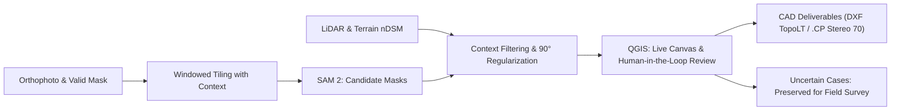

<p align="center">
  <a href="README.md"><b>🇬🇧 English</b></a> &nbsp;•&nbsp;
  <a href="README.ro.md">🇷🇴 Română</a> &nbsp;•&nbsp;
  <a href="README.es.md">🇪🇸 Español</a>
</p>

<p align="center">
  
  
  
  
  
  
</p>

# StratumRO

**The Surveyor's and Geodesist's Platform: Geospatial data, geometric regularization algorithms, and AI orchestrated in an open, deterministic workflow.**

StratumRO operates as an **integrated tool hub powered by open protocols (including MCP – Model Context Protocol)**, designed to enable AI assistants and GIS engineers to orchestrate established geodetic and engineering software: **QGIS Desktop**, **CAD engines** (AutoCAD, Civil 3D, TopoLT), computer vision models (**SAM 2**), LiDAR point cloud analysis (nDSM), and computational geometry.

> [!IMPORTANT]
> **QGIS as the Active Operational Phase 1**: While StratumRO is architected as an extensible platform interfacing with diverse engineering applications (CAD suites, CLI batch compilers, and a future dedicated desktop application), **we currently develop and operate directly within QGIS Desktop**. QGIS serves as our primary interactive cockpit for visual inspection, live canvas verification, and **Human-in-the-Loop** review. Automation accelerates candidate geometry proposals up to the professional decision and legal certification of the licensed surveyor.
>
> 📖 For an in-depth walkthrough of our QGIS live setup, see: [**StratumRO in QGIS (Phase 1 Operational Guide)**](docs/QGIS_WORKFLOW.md).

---

## Executive Summary

- **Active Domain**: **Cadastre is the immediate priority** (reconstruction, separation, and orthogonal regularization of building envelopes in Romanian Stereo 70 EPSG:3844), alongside spatial planning and PUG analytics.
- **Multi-Software Tool Hub**:
  - **QGIS Desktop (Phase 1)**: Visual inspection workstation, canvas control via local MCP socket bridge (port 9876), and master review project [`inspectie_corectii.qgs`](workspace/reviews/body_recovery_20261013/inspectie_corectii.qgs).
  - **CAD Environments**: Native open export to **DXF** (layers and blocks conforming to Romanian TopoLT conventions and ANCPI Order 600/2023) and `.cp` cadastral coordinate exchange tables.
  - **AI & Computer Vision**: Segment Anything Model (SAM 2) candidate masks integrated with LiDAR relative height models (nDSM).
- **Geodetic Rigor**: Zero fake automated certifications. All computations are strictly metric in the national Stereo 70 coordinate reference system.

[Workflow & Architecture](#how-stratumro-works) · [Visual Evidence](#visual-results-from-the-project) · [Mathematical Formulations](#how-results-are-measured) · [Quickstart](#how-to-explore-the-project) · [Documentation](#documentation--resources) · [AI Agent Guide](AGENTS.md)


**Status: Experimental development and evaluation.** The active validated sample in Cluj-Napoca covers **~0.420 km²** (67 tiles with valid RGB data out of 144 planned). The system does not claim unverified city-wide accuracy or precision. Attribute values such as `ADMIS` in code represent internal test gate transitions; no generated geometry constitutes legal cadastral approval without human verification. See [Verified Project State & Limits](docs/PROJECT_STATE.md).

---

## How StratumRO Works

An engineering task begins with an Area of Interest (AOI), available sensor data, and the required legal deliverable. StratumRO leverages proven GIS tooling and maintains full provenance between raw data, computational algorithms, and human verification.



The diagram describes the experimental building workflow. **SAM 2 proposes image segments**; building identification, wing separation, and geometric acceptance require additional verification. LiDAR contributes height context (nDSM); absence of ASPRS Class 6 (buildings) does not automatically reject an observed structure. See [Meta SAM 2](https://github.com/facebookresearch/sam2) and [Regional Implementation](stratum_ro/regional_roofs.py).

| Pipeline Stage | Objective | Existing Implementation |
|---|---|---|
| **Data Preparation** | Stereo 70 CRS, window tiling, valid pixel masking | [Raster core](stratum_ro/core/raster/reader.py), `OrthoMosaic` in [regional_roofs.py](stratum_ro/regional_roofs.py) |
| **Mask Proposal** | Candidate masks from RGB, optional LiDAR nDSM guide | [Roof Workflow](stratum_ro/cadastral_roof_workflow.py) |
| **Geometry & Regularization** | 90° corner snapping, orthogonal regularization, metrics | [Vectorizer](stratum_ro/vectorizer.py), [Metrics](stratum_ro/core/geometry/metrics.py) |
| **QGIS Review (Phase 1)** | Master project, stable identifiers, live canvas sync | [QGIS Guide](docs/QGIS_WORKFLOW.md), [Shared Project](workspace/reviews/body_recovery_20261013/inspectie_corectii.qgs) |
| **CAD/GIS Delivery** | TopoLT layers, `.cp` point tables, GeoPackage bundles | [Cadastre](stratum_ro/cadastral_product.py), [PUG](stratum_ro/pug_product.py), [Dual Generator](tools/build_dual_products.py) |
| **Orchestration & Service** | Local API service and active toolchain bridge | [Platform Service](stratum_ro/api/service.py), [Launcher](start_platform.py) |

---

## Visual Results from the Project

### T10: Local Correction and Discrete Physical Bodies


On the left is the previous incomplete boundary; on the right is the rectified rectangular tiled roof. The low grey annex to the west remains a separate physical object. The screenshot was captured before owner sign-off and retains the historic `PENDING_OWNER_REVIEW` label; **subsequent owner acceptance is recorded in the [T10 Report](workspace/reviews/t10_antigravity_20261013/t10_report.json)**. This represents a locally accepted case without asserting global accuracy across the entire AOI.

### Regional Scan: Automated Window Processing


The canvas view displays candidate proposals and review categories overlaid on orthophotography. Colored contours represent **experimental observations**, including edge cases and ambiguities. [Current Selection](workspace/reviews/regional_roofs_20261017/CURRENT_REVIEW.json) specifies the exact GIS package and report in use.


| Metric | Measured Value & Interpretation |
|---|---|
| Planned Windows | **144**: 67 processed with valid RGB, 77 without valid RGB in core |
| Valid Core Area | **419,681 m²**, approximately **0.420 km²**; does not represent the full city |
| Deduplicated Observations | **2,081**, routed into 380 roof candidates, 644 optical queries, 1,057 probable vegetation |
| Scan Execution Time | **443.4 s** in runtime report; excludes initialization and packaging |
| Precision / Recall | **Not independently benchmarked**; observation count does not equal verified cadastral buildings |

### Ultra-Closeup 1:150 Scale Photogrammetric Audit & Balanced Manhattan Regularization


Transitioning from the flight-overview scale (~1:1200) to true **Surveyor Execution Scale 1:150** (44 m × 25 m canvas window, 1 px = 3.9 cm ground resolution) enabled the systematic cataloging of **9 distinct defect categories (214 anomalies)** across the entire 1.05 km × 1.05 km AOI.

- **Cadastral Invariant: Precision > Minimum Node Count**: Over-simplification thresholds (`hull_ratio >= 0.78`) that collapsed genuine architectural wings into 4-node boxes were eliminated. The `fit_balanced_orthogonal_roof` engine restored **75 articulated structures (L, U, T, porches, and church apses)** with 6–14 nodes at strict 90° Manhattan angles, fully respecting eaves and roof ridges.
- **Spike & Sawteeth Elimination**: Enforcing a minimum cadastral edge length ($\ge 1.20\text{ m}$) and suppressing acute mask artifacts ($< 75^\circ$) ensures pristine, professional cadastre geometries with **100.0% 90° orthogonality**.
- **Consolidated Deliverable (`b_proposals_cleaned.gpkg`)**: 195 active validated 1CC bodies (-0.40m setback), 0 spikes, 19 duplicate candidates suppressed against protected Lot 1–5 Ground Truth.
- **Interactive Review Galleries**: Explore the [1:150 Before vs After Inspection Gallery](http://127.0.0.1:8769/scara_150_ultra_detaliu/index.html) and the [Cadastral Quality Charts Dashboard](http://127.0.0.1:8769/scara_150_ultra_detaliu/charts.html).

---

## How Results Are Measured

Formulas tie pixel coordinates to legal geodetic positions and enable rigorous evaluation against certified ground references. Complete methodology is documented in [Methods and Sources](docs/METHODS_AND_SOURCES.md).

### 1. From Pixel Coordinates to Projected Metric Area

For raster column $u$ and row $v$, the affine transformation is:

$$
x = au + bv + c, \qquad y = du + ev + f
$$

Coefficients derive from the GeoTIFF georeference; pixel center uses $u=\mathrm{col}+0.5$ and $v=\mathrm{row}+0.5$. In a projected metric CRS (Stereo 70), a pixel covers $|ae-bd|$ m². Given valid mask $M_{ij}\in\{0,1\}$:

$$
A_{\mathrm{valid}} = \sum_{i,j} M_{ij}\,|ae-bd|
$$

### 2. LiDAR Contribution (nDSM)

Relative elevation above ground level is determined by:

$$
h(x,y)=\mathrm{DSM}(x,y)-\mathrm{DTM}(x,y)
$$

The subtraction requires strict grid alignment, matching CRS, identical units, and identical vertical datum. LiDAR provides independent physical evidence to differentiate elevated structures from bare earth or low ground.

### 3. Spatial Overlap (IoU) and Boundary Error

For predicted polygon $P$ and ground reference $R$, the Intersection-over-Union is:

$$
\mathrm{IoU}(P,R)=\frac{\mathrm{Area}(P\cap R)}{\mathrm{Area}(P\cup R)}
$$


Because high IoU can still conceal metric boundary errors, StratumRO evaluates the symmetric Root Mean Square Error along polygon boundaries:

$$
\mathrm{RMSE}_{\partial}=\sqrt{\frac{\sum_{p\in S_P}d(p,\partial R)^2+\sum_{r\in S_R}d(r,\partial P)^2}{|S_P|+|S_R|}}
$$

$S_P$ and $S_R$ are points sampled along exterior perimeters (default step: 0.20 m); $d$ is the minimum Euclidean distance to the opposite boundary. See [Metric Implementation](stratum_ro/core/geometry/metrics.py).

---

## Current Status and Roadmap

| Domain | Implemented / Demonstrated | Next Milestone |
|---|---|---|
| **QGIS Workflow (Phase 1)** | Shared master project, live inspection, MCP socket bridge | Expansion to new cadastral sectors and UI streamlining |
| **Roofs & Computer Vision** | SAM 2, regional tiling, LiDAR nDSM guidance, vectorization | Independent benchmark, reduction of multi-part fragmentations |
| **Cadastre & ANCPI** | DXF exports conforming to TopoLT, `.cp` tables, Stereo 70 GPKG | Unification of generator callers; removal of mock `ADMIS` strings |
| **Urban Planning / PUG** | Derived indicators (POT/CUT), green space balance layers | Harmonization with officially approved municipal PUG regulations |
| **Standalone Platform** | Local daemon launcher, modular open architecture | Self-contained desktop package (`.exe`) and automated job runner |

---

## How to Explore the Project

### 1. Inspect in QGIS Desktop (Phase 1)
Open the master workstation project:
```text
workspace/reviews/body_recovery_20261013/inspectie_corectii.qgs
```
This environment retains lots, candidate reviews, and orthophoto layers in a structured hierarchy. See [QGIS Operational Guide](docs/QGIS_WORKFLOW.md).

### 2. Launch the Local Service
From the repository root with the configured environment:
```powershell
.\venv\Scripts\python.exe start_platform.py
```
Starts the API service at `http://127.0.0.1:8000` (interactive documentation at `/docs`) and listens for QGIS socket commands on port `9876`.

### 3. Run Automated Validation & Tests
The CI test suite runs on Windows/Linux under Python 3.10 and 3.11:
```powershell
python scripts/validate_project.py --mode fast
python -m unittest discover stratum_ro/test
python tools/verify_ground_truth_and_metrics.py
```
The official test suite verifies **over 500 unit and integration tests** (with 9 conditionally skipped when QGIS GUI runtime is absent).

---

## Documentation & Resources

| Topic | Reference Document |
|---|---|
| 🗺️ **QGIS Operational Workflow (Phase 1)** | [**docs/QGIS_WORKFLOW.md**](docs/QGIS_WORKFLOW.md) |
| 🤖 **AI Agent Navigation & Guidelines** | [**AGENTS.md**](AGENTS.md) · [GEMINI.md](GEMINI.md) · [CLAUDE.md](CLAUDE.md) |
| 📊 **Verified Project State & Limitations** | [docs/PROJECT_STATE.md](docs/PROJECT_STATE.md) |
| 📐 **System Map & Component Architecture** | [docs/SYSTEM_MAP.md](docs/SYSTEM_MAP.md) |
| 📚 **Mathematical Methods & Provenance** | [docs/METHODS_AND_SOURCES.md](docs/METHODS_AND_SOURCES.md) |
| 🏛️ **Repository Guide & Git Hygiene** | [docs/REPOSITORY_GUIDE.md](docs/REPOSITORY_GUIDE.md) |
| 📋 **Complete Documentation Index** | [docs/README.md](docs/README.md) |

---

## Licenses

Platform source code is licensed under [Apache 2.0](LICENSE); certain inherited QGIS plugin components carry GPL v2+ headers. Review individual module headers prior to commercial distribution.
