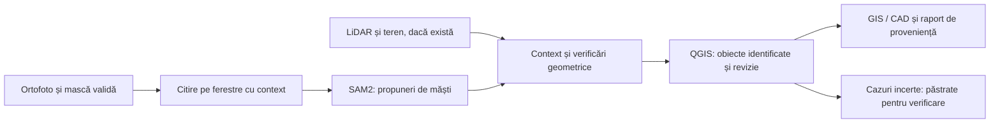

# StratumRO

**Platforma geodezului: date, algoritmi și aplicații specializate într-un flux de lucru comun.**

StratumRO conectează instrumente precum **QGIS** cu procesarea raster, nori de puncte, geometrie computațională și AI. Scopul produsului este o aplicație proprie în care utilizatorul descrie lucrarea, iar sistemul pregătește datele, execută operațiile și livrează rezultate verificabile. **Cadastrul este prioritatea actuală**, alături de componente pentru urbanism/PUG; platforma are un scop mai larg decât extragerea clădirilor.

[Flux și arhitectură](#cum-lucrează-stratumro) · [Rezultate vizuale](#rezultate-vizuale-din-proiect) · [Formule](#cum-se-măsoară-rezultatul) · [Pornire](#cum-explorezi-proiectul) · [Documentație](#documentație-și-continuare) · [Surse](#surse-tehnice)


**Stadiu: dezvoltare și evaluare experimentală.** Există cod executabil, integrare QGIS, rezultate GIS/CAD și rulări regionale reale. Automatizarea completă pentru orice zonă și un instalator desktop final sunt obiective în lucru. [Starea verificată și limitele componentelor](docs/PROJECT_STATE.md) sunt documentate separat.

## Cum lucrează StratumRO

O lucrare pornește de la zona de interes, datele disponibile și livrabilul cerut. StratumRO reutilizează instrumentele GIS existente și păstrează legătura dintre sursă, rezultat și verificare.



Diagrama descrie traseul experimental al acoperișurilor. **SAM2 propune segmente de imagine**; identificarea unei clădiri, separarea corpurilor și acceptarea geometriei cer verificări suplimentare. LiDAR poate aduce înălțime și context; lipsa punctelor din clasa 6 nu respinge automat o clădire. [SAM2 oficial](https://github.com/facebookresearch/sam2), [implementarea regională](stratum_ro/regional_roofs.py).

| Etapă | Ce urmărește | Implementare existentă |
|---|---|---|
| Pregătirea datelor | CRS, ferestre, vecini, mască de pixeli valizi | [Raster core](stratum_ro/core/raster/reader.py), `OrthoMosaic` în [regional_roofs.py](stratum_ro/regional_roofs.py) |
| Propunerea obiectelor | Măști din ortofoto, sprijin LiDAR opțional | [Flux de acoperișuri](stratum_ro/cadastral_roof_workflow.py) |
| Geometrie și evaluare | Forme simple susținute de date, obiecte distincte, metrici | [Vectorizare](stratum_ro/vectorizer.py), [metrici](stratum_ro/core/geometry/metrics.py) |
| Revizie în proiect | Identificatori stabili, ipoteze și verdicte explicite | [Rutare regională](stratum_ro/regional_review.py), [proiect QGIS comun](workspace/reviews/body_recovery_20261013/inspectie_corectii.qgs) |
| Livrare | Pachete GIS/CAD, straturi și atribute | [Cadastru](stratum_ro/cadastral_product.py), [PUG](stratum_ro/pug_product.py), [generator dual](tools/build_dual_products.py) |
| Coordonare | Serviciu și acces la instrumentele existente | [Serviciul platformei](stratum_ro/api/service.py), [launcher](start_platform.py) |

Integrarea nucleului este în curs: unele fluxuri folosesc încă implementări anterioare. Extinderea se face prin apelanții existenți; [harta sistemului](docs/SYSTEM_MAP.md) distinge componentele prezente de arhitectura dorită.

## Rezultate vizuale din proiect

### T10: corecție locală și corpuri păstrate separat


În stânga este conturul anterior, incomplet; în dreapta, dreptunghiul rectificat al acoperișului din țiglă. Corpul jos, gri, din vest rămâne un obiect separat. Imaginea a fost capturată înaintea verdictului și păstrează inscripția istorică `PENDING_OWNER_REVIEW`; **acceptarea ulterioară a proprietarului este consemnată în [raportul T10](workspace/reviews/t10_antigravity_20261013/t10_report.json)**. Este un caz local acceptat vizual, fără a stabili precizia întregii zone sau amprenta la sol.

### Scanare regională: procesare pe ferestre, fără alegerea manuală a fiecărei clădiri


Vederea arată propunerile și categoriile de revizie peste ortofoto. Contururile colorate sunt **observații experimentale**, inclusiv erori și cazuri incerte. [Selecția curentă](workspace/reviews/regional_roofs_20261017/CURRENT_REVIEW.json) indică pachetul GIS și raportul folosit; nu alege rezultatele doar după numele directorului.


| Măsurare | Valoare și interpretare |
|---|---|
| Ferestre planificate | **144**: 67 procesate cu RGB valid, 77 fără RGB valid în nucleu |
| Arie validă a nucleelor | **419.681 m²**, aproximativ **0,420 km²**; nu reprezintă întregul municipiu |
| Observații deduplicate | **2.081**, apoi 380 candidați de acoperiș, 644 optic incerte, 1.057 vegetație probabilă |
| Execuția scanării | **443,4 s** în raportul rulării; exclude inițializarea și ambalarea ulterioară a reviziei |
| Precizie / recall | **Nemăsurate independent**; numărul de observații nu este numărul clădirilor corecte |

Sursa măsurătorilor este [raportul scanării](workspace/reviews/regional_roofs_20261017/scan_v1/report.json); distribuția graficului este din [rutarea revizuită](workspace/reviews/regional_roofs_20261017/masked_review_v2/mask_guard_report.json). Inferența reală a folosit `1d9685e`; rutarea și masca ulterioară au fost aplicate observațiilor salvate. Aceasta nu echivalează cu o nouă rulare integrală a ultimei versiuni combinate. [Metodă, mediu și limite](docs/STRATUMRO_REGIONAL_AUTOMATION_AND_HF_2026-10-17.md).

## Cum se măsoară rezultatul

Formulele leagă imaginea de coordonate și permit evaluarea unei geometrii față de o referință adecvată. Exemplele didactice de mai jos nu sunt scoruri de performanță ale proiectului. [Metodele complete, convențiile și sursele](docs/METHODS_AND_SOURCES.md) includ detaliile implementării.

### 1. Din pixel în coordonate și suprafață

Pentru coloana $u$ și rândul $v$, transformarea afină a rasterului este:

$$
x = au + bv + c, \qquad y = du + ev + f
$$

Coeficienții provin din georeferențiere; centrul pixelului folosește $u=\mathrm{col}+0{,}5$ și $v=\mathrm{row}+0{,}5$. Într-un CRS proiectat în metri, suprafața unui pixel este $|ae-bd|$ m². Cu masca validă $M_{ij}\in\{0,1\}$:

$$
A_{\mathrm{valid}} = \sum_{i,j} M_{ij}\,|ae-bd|
$$

**Exemplu:** la 0,15 m/pixel, un pixel nord-orientat are 0,0225 m²; 10.000 pixeli valizi acoperă 225 m². NoData provine din măștile și metadatele sursei; un acoperiș întunecat poate fi imagine validă. [GDAL: geotransformări](https://gdal.org/en/stable/tutorials/geotransforms_tut.html), [Rasterio: măști](https://rasterio.readthedocs.io/en/stable/topics/masks.html).

### 2. Ce aduce LiDAR

Principiul înălțimii relative deasupra terenului este:

$$
h(x,y)=\mathrm{DSM}(x,y)-\mathrm{DTM}(x,y)
$$

DSM descrie suprafața superioară, DTM terenul. Scăderea are sens după alinierea grilelor, CRS-ului, unităților și referinței verticale, numai unde ambele au date valide. O suprafață înaltă poate fi clădire sau vegetație. Ortofoto rămâne imagine RGB; suportul LiDAR este o sursă separată de dovezi. [Cititorul și diferența raster](stratum_ro/core/raster/reader.py) verifică dimensiunile și valoarea NoData configurată, dar nu certifică singure alinierea geodezică. Fluxul regional consumă grile de context deja pregătite.

### 3. Suprapunere și eroare de contur

Pentru predicția $P$ și referința $R$, scorul de suprapunere este:

$$
\mathrm{IoU}(P,R)=\frac{\mathrm{Area}(P\cap R)}{\mathrm{Area}(P\cup R)}
$$


IoU este între 0 și 1 și nu exprimă o distanță în metri. În exemplu, decalajul de 1 m produce încă IoU ≈ 0,818. De aceea codul calculează și eroarea simetrică a conturului:

$$
\mathrm{RMSE}_{\partial}=\sqrt{\frac{\sum_{p\in S_P}d(p,\partial R)^2+\sum_{r\in S_R}d(r,\partial P)^2}{|S_P|+|S_R|}}
$$

$S_P$ și $S_R$ sunt puncte eșantionate pe contururile exterioare; $d$ este distanța minimă la celălalt contur. Rezultatul este în metri pentru un CRS metric. Implementarea folosește implicit un pas de 0,20 m și completează aceste metrici cu distanța Hausdorff și deplasarea centrului. [Codul metricilor](stratum_ro/core/geometry/metrics.py), [operații Shapely](https://shapely.readthedocs.io/en/stable/measurement.html).

Un scor are sens când referința reprezintă același obiect și aceeași țintă geometrică. **Acoperișul observat și amprenta la sol sunt ținte diferite.** GMW mixt și predicțiile neacceptate nu sunt etichete curate de antrenare sau referințe cadastrale independente.

## Ce există acum și ce urmează

| Domeniu | Implementat / demonstrat | Următoarea condiție de maturizare |
|---|---|---|
| Acoperișuri | SAM2, ferestre regionale, context LiDAR, vectorizare și revizie | Evaluare independentă, reducerea erorilor și păstrarea obiectelor complete |
| Cadastru | Generatoare și exporturi GPKG, DXF, `.cp` | Consolidarea apelanților și stări de verificare corecte; atributul `ADMIS` generat în cod nu dovedește acceptare externă |
| Urbanism/PUG | Straturi și indicatori derivați, arbori și reprezentări 3D | Etichetarea estimărilor; grila analitică de 150 m nu constituie UTR oficial |
| Integrare | Plugin/provider QGIS, API și interfață web existente | Verificarea conexiunilor pe fiecare flux și extinderea adaptoarelor |
| Aplicație proprie | Launcher Python pentru serviciul existent | Pachet desktop instalabil și traseu verificat de la cerere la livrare |
| Modele / Hugging Face | SAM2 în fluxul actual; opțiuni de modele documentate | Etichete curate și benchmark înaintea antrenării ori schimbării modelului |

Hugging Face poate distribui modele și date; nu este o condiție obligatorie și nu repară automat contururile. Migrarea în Rust nu este necesară pentru a verifica fluxul actual. Prioritatea este reutilizarea nucleului, integrarea și rezultate măsurabile. [Identitatea produsului](docs/STRATUMRO_PRODUCT_IDENTITY_AND_DESKTOP_DIRECTION_2026-10-17.md), [probleme deschise](docs/PROJECT_STATE.md).

## Cum explorezi proiectul

### Vezi rezultatele în QGIS

Proiectul comun al stației de lucru este [inspectie_corectii.qgs](workspace/reviews/body_recovery_20261013/inspectie_corectii.qgs). Acesta păstrează loturile și reviziile în același loc. Pentru evaluarea regională urmărește [CURRENT_REVIEW.json](workspace/reviews/regional_roofs_20261017/CURRENT_REVIEW.json); pentru Lot3/Lot4, [starea proiectului](docs/PROJECT_STATE.md) indică selecțiile active.

Un clone Git nu include toate ortofotourile, modelele sau fișierele LAS/LAZ. Verifică disponibilitatea și căile datelor înainte de a interpreta un strat lipsă. [Structură și politică de date](docs/REPOSITORY_GUIDE.md).

### Pornește interfața existentă pe stația configurată

Din rădăcina repository-ului, cu mediul existent:

```powershell
.\venv\Scripts\python.exe start_platform.py
```

Launcherul pornește serviciul local la `http://127.0.0.1:8000`, cu documentația API la `/docs`, și verifică puntea QGIS locală pe portul 9876. Fără QGIS detectat, poate afișa straturi cache/mock; pornirea interfeței nu demonstrează conectarea la datele live. Aceasta este intrarea actuală Python/web, nu instalatorul desktop final. [Sursa launcherului](start_platform.py).

### Verifică software-ul

CI verifică Linux/Windows cu Python 3.10/3.11. Configurația instalează torch CPU și [requirements-ci.txt](requirements-ci.txt), apoi execută:

```text
python scripts/validate_project.py --mode fast
python -m unittest discover stratum_ro/test
python tools/verify_ground_truth_and_metrics.py
```

[Rularea verificată pentru `e6011fa`](https://github.com/lefterpatrickandrei-sketch/StratumRO-QGIS/actions/runs/39120165207) a trecut cele patru joburi; suita din fiecare job raportează **450 teste trecute și 9 omise pentru context QGIS**. [CI curent](https://github.com/lefterpatrickandrei-sketch/StratumRO-QGIS/actions/workflows/ci.yml), [dovezi și reparații CI](workspace/ci_repair_20261018/README.md). Aceste verificări nu măsoară acuratețea contururilor. Inferența SAM2/GPU și o instalare completă pe o stație nouă au cerințe separate.

## Documentație și continuare

| Vreau să înțeleg… | Document |
|---|---|
| Ce funcționează și ce mai lipsește | [Starea proiectului](docs/PROJECT_STATE.md) |
| Componentele și relațiile lor | [Harta sistemului](docs/SYSTEM_MAP.md) |
| Formulele, convențiile și legătura cu codul | [Metode și surse](docs/METHODS_AND_SOURCES.md) |
| Cum este organizat repository-ul | [Ghidul repository-ului](docs/REPOSITORY_GUIDE.md) |
| Cum continuă orice agent | [AGENTS.md](AGENTS.md), [predarea comună](docs/AGENT_HANDOFF.md) |
| De ce acceptăm sau respingem un contur | [Protocolul deciziilor](docs/STRATUMRO_AGENT_DECISION_PROTOCOL.md), [porțile de evaluare](docs/STRATUMRO_EVALUATION_GATES.md) |
| Ce s-a arhivat și cum restaurez | [junk/](junk/README.md), [manifestul mutărilor](workspace/repository_cleanup_20261018/migration_manifest.json) |
| Cum sunt generate graficele de aici | [Scriptul figurilor](workspace/readme_publication_20261018/build_figures.py), [proveniența](workspace/readme_publication_20261018/figure_manifest.json) |
| Toate intrările de documentație | [Index](docs/README.md) |

Citește regulile comune înaintea modificărilor. Folosește aceeași copie de proiect, verifică apelanții existenți și salvează în checkpointuri codul, textele, imaginile și datele utile. Fișierele pentru Codex, Gemini/Antigravity, Claude și Kilo trimit la aceleași reguli; nu transferă automat conversațiile dintre aplicații.

## Surse tehnice

- [GDAL — Geotransform Tutorial](https://gdal.org/en/stable/tutorials/geotransforms_tut.html): transformarea afină, convenția rând/coloană și centrul pixelului.
- [Rasterio — Nodata Masks](https://rasterio.readthedocs.io/en/stable/topics/masks.html): validitatea rasterului și convențiile măștilor.
- [QGIS — PyQGIS Processing](https://docs.qgis.org/3.40/en/docs/pyqgis_developer_cookbook/processing.html): reutilizarea algoritmilor și providerelor.
- [Meta — SAM2, cod oficial](https://github.com/facebookresearch/sam2) și [lucrarea SAM 2](https://arxiv.org/abs/2408.00714): segmentare promptabilă, modele și limitele sarcinii.
- [Shapely — Measurement](https://shapely.readthedocs.io/en/stable/measurement.html): arii și distanțe geometrice.
- [pyproj — Transformer](https://pyproj4.github.io/pyproj/stable/api/transformer.html): transformări CRS și ordinea axelor.

Aceste surse explică metodele și bibliotecile; rezultatele StratumRO sunt susținute separat de rapoartele și artefactele din repository.

## Licențe

Fișierul [LICENSE](LICENSE) din rădăcină este Apache 2.0; unele surse ale pluginului au antete GPL. Licențele componentelor, modelelor și datelor trebuie clarificate înainte de distribuție. Documentația nu declară o licență unică verificată pentru întregul produs.
