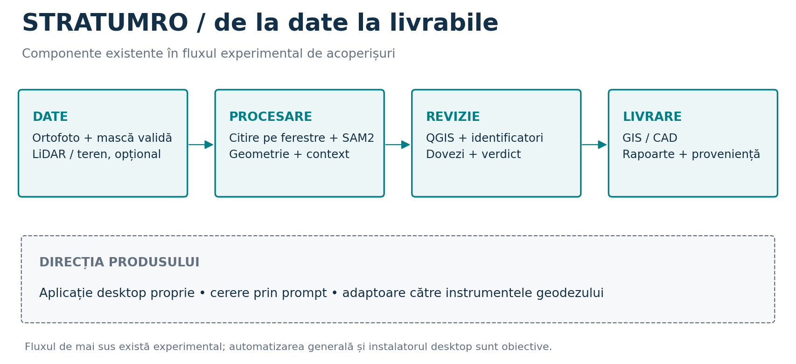
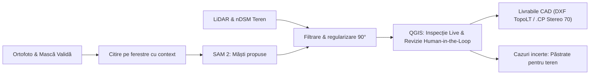
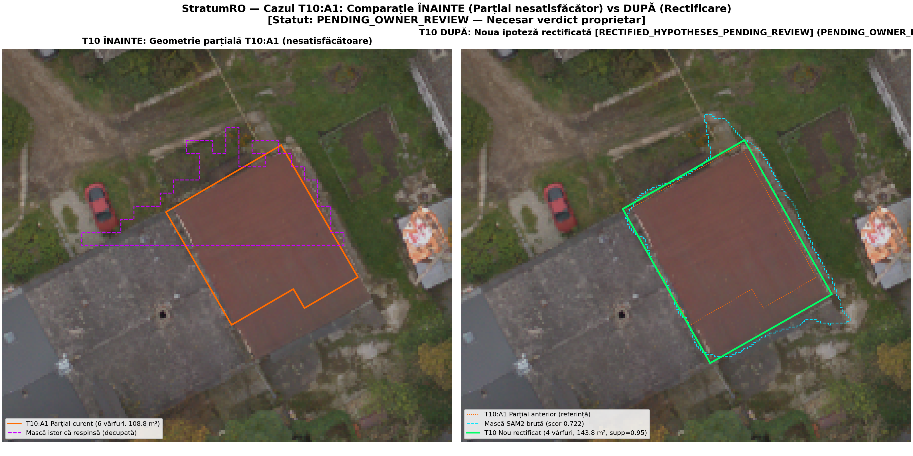
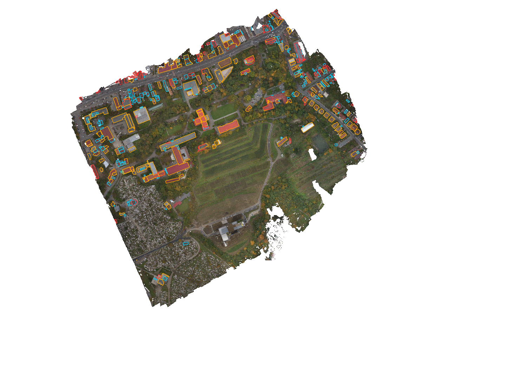
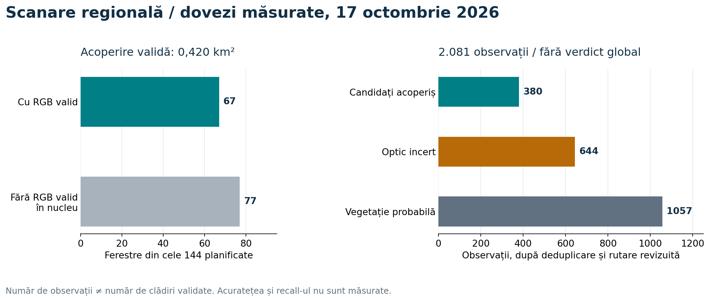
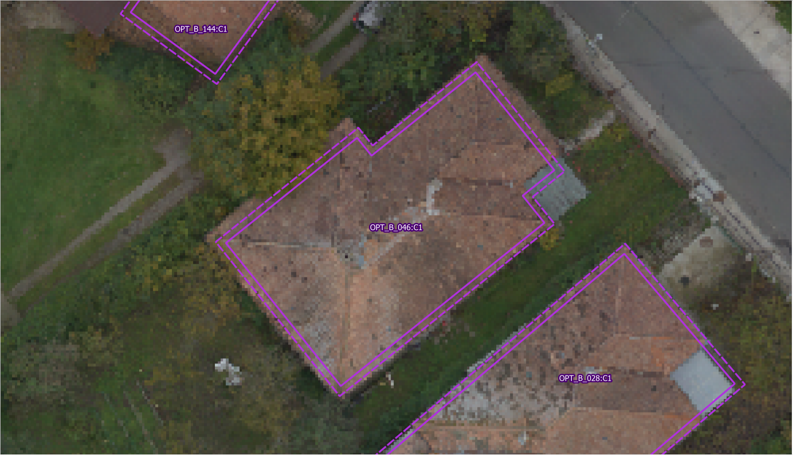
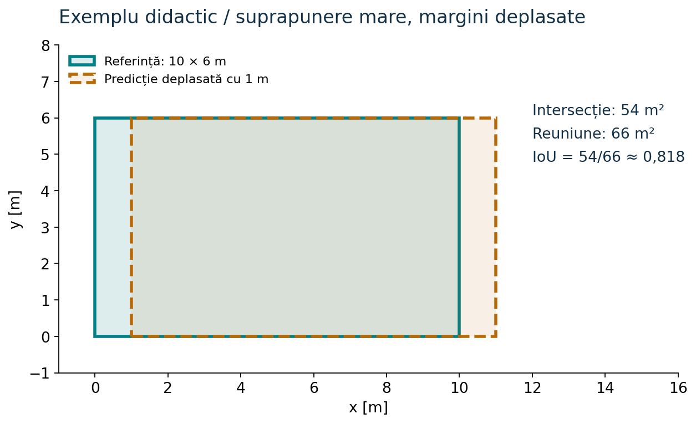

<p align="center">
  <a href="README.md">🇬🇧 English</a> &nbsp;•&nbsp;
  <a href="README.ro.md"><b>🇷🇴 Română</b></a> &nbsp;•&nbsp;
  <a href="README.es.md">🇪🇸 Español</a>
</p>

<p align="center">
  
  
  
  
  
  
</p>

# StratumRO

**Platforma geodezului și a topografului: date geospațiale, algoritmi de regularizare și inteligență artificială orchestrate într-un flux de lucru deschis.**

StratumRO funcționează ca un **hub integrat de unelte bazat pe protocoale standardizate (inclusiv MCP – Model Context Protocol)**, conceput pentru a permite asistenților AI și specialiștilor GIS să orchestreze software-urile consacrate din geodezie și inginerie: **QGIS Desktop**, **motoare CAD** (AutoCAD, Civil 3D, TopoLT), module de viziune artificială (**SAM 2**), analiză de nori de puncte LiDAR (nDSM) și geometrie computațională.

> [!IMPORTANT]
> **QGIS ca Faza 1 operațională activă**: Deși StratumRO este proiectat ca o platformă extensibilă capabilă să alimenteze multiple aplicații inginerești (CAD, generatoare CLI și viitoarea interfață desktop dedicată), **în prezent lucrăm și dezvoltăm nemijlocit în QGIS Desktop**. QGIS reprezintă stația noastră de lucru primară pentru inspecție vizuală, verificare pe canvas live și revizie asistată uman (**Human-in-the-Loop**). Automatizarea pregătește propunerile până la decizia și semnătura profesională a geodezului autorizat.
>
> 📖 Pentru detalii complete despre fluxul de lucru operațional, consultă ghidul dedicat: [**StratumRO în QGIS (Ghid Operațional Faza 1)**](docs/QGIS_WORKFLOW.md).

---

## Privire de ansamblu

- **Domenii active**: **Cadastrul este prioritatea actuală** (reconstituirea, separarea și regularizarea geometrică a corpurilor de clădire în Stereo 70 EPSG:3844 conform legislației românești), alături de componente analitice pentru urbanism și PUG.
- **Ecosistem multi-software**:
  - **QGIS Desktop (Faza 1)**: Mediu de inspecție vizuală, control pe canvas prin socket bridge MCP (portul 9876) și proiectul master [`inspectie_corectii.qgs`](workspace/reviews/body_recovery_20261013/inspectie_corectii.qgs).
  - **Medii CAD**: Export nativ deschis în format **DXF** (straturi și blocuri conforme normelor TopoLT și Ordinului ANCPI 600/2023) și fișiere de coordonate cadastrale `.cp`.
  - **AI & Viziune Computațională**: Extragere de măști prin Meta SAM 2, corelate cu înălțimi relative deasupra terenului din LiDAR nDSM.
- **Rigoare geodezică**: Fără avizări automate fictive. Calculele sunt strict metrice în proiecția națională Stereo 70.

[Flux și arhitectură](#cum-lucrează-stratumro) · [Rezultate vizuale](#rezultate-vizuale-din-proiect) · [Formule matematice](#cum-se-măsoară-rezultatul) · [Pornire rapidă](#cum-explorezi-proiectul) · [Documentație](#documentație-și-continuare) · [Ghid Agenți AI](AGENTS.md)



**Stadiu: dezvoltare și evaluare experimentală.** Suprafața analizată pe Cluj-Napoca este de **~0,420 km²** (67 ferestre cu date RGB valide din 144 planificate). Sistemul nu oferă o precizie sau un recall măsurate independent la scara întregului municipiu. Atributele de tip `ADMIS` din cod reprezintă stări tranzitorii ale porților de testare; nicio propunere nu are valoare de avizare cadastrală fără asumarea specialistului. [Starea verificată și limitele componentelor](docs/PROJECT_STATE.md) sunt documentate detaliat.

---

## Cum lucrează StratumRO

O lucrare pornește de la zona de interes (AOI), datele senzoriale disponibile și livrabilul cerut. StratumRO reutilizează instrumentele GIS consacrate și păstrează legătura indisolubilă dintre sursa de date, algoritmul aplicat și verificarea umană.



Diagrama descrie traseul experimental al acoperișurilor. **SAM 2 propune segmente de imagine**; identificarea unei clădiri, separarea corpurilor și acceptarea geometriei cer verificări suplimentare. LiDAR aduce diferența de înălțime (nDSM); lipsa punctelor din clasa 6 (clădiri) nu respinge automat un corp de clădire. [SAM 2 oficial](https://github.com/facebookresearch/sam2), [implementarea regională](stratum_ro/regional_roofs.py).

| Etapă | Ce urmărește | Implementare existentă |
|---|---|---|
| **Pregătirea datelor** | CRS Stereo 70, tiling cu suprapunere, mască pixeli valizi | [Raster core](stratum_ro/core/raster/reader.py), `OrthoMosaic` în [regional_roofs.py](stratum_ro/regional_roofs.py) |
| **Propunerea măștilor** | Măști candidate din ortofoto, ghidaj opțional nDSM | [Flux acoperișuri](stratum_ro/cadastral_roof_workflow.py) |
| **Geometrie & Evaluare** | Forme rectangulare, unghiuri de 90°, regularizare ortogonală | [Vectorizare](stratum_ro/vectorizer.py), [metrici](stratum_ro/core/geometry/metrics.py) |
| **Revizie în QGIS (Faza 1)** | Proiect master comun, identificatori stabili, comenzi live | [Ghid QGIS](docs/QGIS_WORKFLOW.md), [proiect comun](workspace/reviews/body_recovery_20261013/inspectie_corectii.qgs) |
| **Livrare CAD/GIS** | Straturi TopoLT, tabele `.cp`, pachete GeoPackage | [Cadastru](stratum_ro/cadastral_product.py), [PUG](stratum_ro/pug_product.py), [generator dual](tools/build_dual_products.py) |
| **Orchestrare & Serviciu** | Serviciu local și acces la instrumentele active | [Serviciul platformei](stratum_ro/api/service.py), [launcher](start_platform.py) |

---

## Rezultate vizuale din proiect

### T10: Corecție locală și corpuri păstrate separat



În stânga este conturul anterior, incomplet; în dreapta, dreptunghiul rectificat al acoperișului din țiglă. Corpul jos, gri, din vest rămâne un obiect separat. Imaginea a fost capturată înaintea verdictului și păstrează inscripția istorică `PENDING_OWNER_REVIEW`; **acceptarea ulterioară a proprietarului este consemnată în [raportul T10](workspace/reviews/t10_antigravity_20261013/t10_report.json)**. Este un caz local acceptat vizual, fără a stabili precizia întregii zone sau amprenta la sol.

### Scanare regională: procesare automată pe ferestre



Vederea arată propunerile și categoriile de revizie peste ortofoto. Contururile colorate sunt **observații experimentale**, inclusiv erori și cazuri incerte. [Selecția curentă](workspace/reviews/regional_roofs_20261017/CURRENT_REVIEW.json) indică pachetul GIS și raportul folosit.



| Măsurare | Valoare și interpretare |
|---|---|
| Ferestre planificate | **144**: 67 procesate cu RGB valid, 77 fără RGB valid în nucleu |
| Arie validă a nucleelor | **419.681 m²**, aproximativ **0,420 km²**; nu reprezintă întregul municipiu |
| Observații deduplicate | **2.081**, apoi 380 candidați de acoperiș, 644 optic incerte, 1.057 vegetație probabilă |
| Scan Execution Time | **443,4 s** în raportul rulării; exclude inițializarea și ambalarea reviziei |
| Precizie / recall | **Nemăsurate independent**; numărul de observații nu este numărul clădirilor corecte |

### Inspecție Cadastrală Ultra-Detaliu la Scară 1:150 & Remediere Balansată



Trecerea de la zborul fotogrammetric de ansamblu (~1:1200) la **Scara Cadastrală de Execuție 1:150** (fereastră 44 m × 25 m, rezoluție 1 px = 3.9 cm) a permis recensământul a **9 categorii sistematice de defecte (214 anomalii)** pe tot perimetrul de 1.05 km².

- **Regulă aplicată: Precizie > Număr mic de noduri**: A fost eliminată aplatizarea forțată a acoperișurilor în cutii oarbe de 4 noduri (`hull_ratio >= 0.78`). Algoritmul `fit_balanced_orthogonal_roof` a restaurat **75 de corpuri articulate (forme în L, U, T, verande, abside bazilicale)** cu 6–14 noduri la 90°, conservând decroșurile și doliile reale.
- **Eliminarea spike-urilor și zimților**: Impunerea unei laturi minime $\ge 1.20\text{ m}$ și eliminarea colților ascuțiți sub 75° garantează poligoane curate, profesionale, 100% ortogonale.
- **Livrabil activ consolidat**: 195 clădiri validate 1CC, 0 spike-uri, 19 dubluri eliminate față de Lot 1–5 Ground Truth.
- **Inspecție interactivă**: Consultați [Galeria 1:150 Înainte vs După](http://127.0.0.1:8769/scara_150_ultra_detaliu/index.html) și [Dashboard-ul de Grafice](http://127.0.0.1:8769/scara_150_ultra_detaliu/charts.html).

---

## Cum se măsoară rezultatul

Formulele leagă imaginea de coordonate și permit evaluarea unei geometrii față de o referință adecvată. Exemplele de mai jos explică modul de calcul. Detaliile complete sunt în [Metode și surse](docs/METHODS_AND_SOURCES.md).

### 1. Din pixel în coordonate și suprafață

Pentru coloana $u$ și rândul $v$, transformarea afină a rasterului este:

$$
x = au + bv + c, \qquad y = du + ev + f
$$

Coeficienții provin din georeferențiere; centrul pixelului folosește $u=\mathrm{col}+0{,}5$ și $v=\mathrm{row}+0{,}5$. Într-un CRS proiectat în metri (Stereo 70), suprafața unui pixel este $|ae-bd|$ m². Cu masca validă $M_{ij}\in\{0,1\}$:

$$
A_{\mathrm{valid}} = \sum_{i,j} M_{ij}\,|ae-bd|
$$

### 2. Contribuția LiDAR (nDSM)

Principiul înălțimii relative deasupra terenului:

$$
h(x,y)=\mathrm{DSM}(x,y)-\mathrm{DTM}(x,y)
$$

Scăderea are sens după alinierea strictă a grilelor, CRS-ului, unităților și referinței verticale. Ortofoto rămâne imagine RGB; suportul LiDAR este o sursă complementară de validare geometrică.

### 3. Suprapunere (IoU) și eroare de contur

Pentru predicția $P$ și referința $R$, scorul de suprapunere este:

$$
\mathrm{IoU}(P,R)=\frac{\mathrm{Area}(P\cap R)}{\mathrm{Area}(P\cup R)}
$$



Pentru a măsura precizia metrică a laturilor, codul evaluează eroarea pătratică medie simetrică pe contur:

$$
\mathrm{RMSE}_{\partial}=\sqrt{\frac{\sum_{p\in S_P}d(p,\partial R)^2+\sum_{r\in S_R}d(r,\partial P)^2}{|S_P|+|S_R|}}
$$

$S_P$ și $S_R$ sunt puncte eșantionate pe contururile exterioare (pas implicit 0,20 m); $d$ este distanța minimă până la celălalt contur. [Codul metricilor](stratum_ro/core/geometry/metrics.py).

---

## Ce există acum și ce urmează

| Domeniu | Implementat / demonstrat | Următoarea condiție de maturizare |
|---|---|---|
| **Flux QGIS (Faza 1)** | Proiect master comun, inspecție vizuală, socket bridge MCP | Extindere la noi loturi cadastrale și rafinare dialoguri |
| **Acoperișuri & Viziune** | SAM 2, ferestre regionale, context LiDAR nDSM, vectorizare | Evaluare independentă, reducerea fragmentării la clădiri mari |
| **Cadastru & ANCPI** | Exporturi DXF conforme TopoLT, tabele `.cp`, GPKG Stereo 70 | Consolidarea apelanților; eliminarea atributelor `ADMIS` automate |
| **Urbanism / PUG** | Straturi și indicatori derivați (POT/CUT), spații verzi | Corelarea cu PUG-ul oficial aprobat |
| **Platformă proprie** | Launcher Python pentru serviciul local, arhitectură deschisă | Pachet desktop instalabil și flux continuu de lucru |

---

## Cum explorezi proiectul

### 1. Inspecția în QGIS Desktop (Faza 1)
Deschide proiectul master al stației de lucru:
```text
workspace/reviews/body_recovery_20261013/inspectie_corectii.qgs
```
Acesta păstrează loturile, reviziile și ortofotoplanurile într-un mediu structurat. Consultă [Ghidul Operațional QGIS](docs/QGIS_WORKFLOW.md).

### 2. Pornirea serviciului local
Din rădăcina proiectului:
```powershell
.\venv\Scripts\python.exe start_platform.py
```
Serviciul pornește la `http://127.0.0.1:8000` (documentație API la `/docs`) și ascultă puntea QGIS pe portul `9876`.

### 3. Rularea testelor automate
Configurația CI rulează pe Windows/Linux cu Python 3.10 și 3.11:
```powershell
python scripts/validate_project.py --mode fast
python -m unittest discover stratum_ro/test
python tools/verify_ground_truth_and_metrics.py
```
Suita oficială validează **peste 500 de teste** (cu 9 omise condiționat în lipsa contextului GUI QGIS).

---

## Documentație și resurse

| Obiectiv | Document de referință |
|---|---|
| 🗺️ **Fluxul operațional QGIS (Faza 1)** | [**docs/QGIS_WORKFLOW.md**](docs/QGIS_WORKFLOW.md) |
| 🤖 **Ghidul și orientarea agenților AI** | [**AGENTS.md**](AGENTS.md) · [GEMINI.md](GEMINI.md) · [CLAUDE.md](CLAUDE.md) |
| 📊 **Starea verificată și probleme deschise** | [docs/PROJECT_STATE.md](docs/PROJECT_STATE.md) |
| 📐 **Harta componentelor și arhitectura** | [docs/SYSTEM_MAP.md](docs/SYSTEM_MAP.md) |
| 📚 **Formule matematice și metodologie** | [docs/METHODS_AND_SOURCES.md](docs/METHODS_AND_SOURCES.md) |
| 🏛️ **Ghidul depozitului și igiena Git** | [docs/REPOSITORY_GUIDE.md](docs/REPOSITORY_GUIDE.md) |
| 📋 **Indexul complet al documentației** | [docs/README.md](docs/README.md) |

---

## Licențe

Codul platformei este licențiat sub [Apache 2.0](LICENSE); anumite componente istorice ale pluginului QGIS conțin antete GPL v2+. Consultați licențele fiecărui modul înainte de redistribuire comercială.
