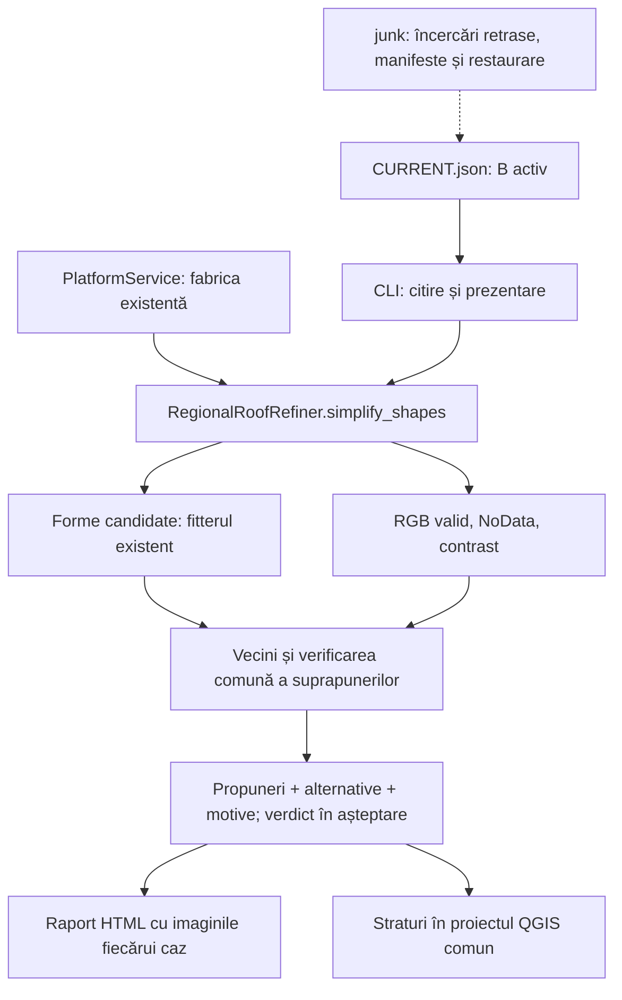

# Fluxul activ pentru clădiri: opțiunea B

Stare: 2026-10-19. Această consolidare privește rafinarea propunerilor B existente. Nu reprezintă un detector complet nou, migrarea întregii platforme sau acceptarea contururilor.

## O singură intrare și aceleași reguli

Selectorul [CURRENT.json](../workspace/building_workflow/CURRENT.json) indică rezultatul activ, observațiile de intrare, configurația cititorului și punctul comun din cod. Nu alegeți o rulare după numele folderului sau după ultimul fișier modificat.



`RegionalRoofRefiner.simplify_shapes(records)` conține acum alegerea variantelor, verificarea cu vecinii inițiali și verificarea comună după schimbarea tuturor obiectelor. Regula nu mai există separat în scriptul de planșe. CLI pregătește datele, apelează motorul comun, exportă și prezintă rezultatul final după verificări.

Apel prin fabrica existentă:

```python
engine = service.create_regional_roof_refiner(orthophotos)
result = engine.simplify_shapes(records)
```

Fiecare înregistrare necesită `candidate_id` unic și `geometry` Polygon valid în EPSG:3844/metri. `baseline_geometry` este opțională și reprezintă propunerea anterioară, nu o referință cadastrală. `qa_status` anterior se păstrează. Rezultatul conține `previous`, `final`, `variants`, `decisions` și conflictele înainte/după. Identitățile și golurile reale nu se unesc automat.

Unealta MCP istorică `vector.refine_regional_roofs` folosește încă traseul de rafinare anterior, fără schimbare ascunsă a contractului. Pentru această etapă B, agenții trebuie să folosească metoda comună sau CLI-ul indicat de selector. Nu afirmați că orice unealtă veche a devenit implicit noul flux.

## Ce rămâne de rezolvat

- Simplificarea nu detectează corpuri lipsă și nu repară automat contururi trunchiate, de exemplu B120.
- Sprijinul pe mască și contrastul optic nu sunt măsurători independente de precizie. Limitele de dezvoltare nu sunt toleranțe cadastrale.
- Formele T și cu decalaje nu sunt diferențiate sigur doar din opt colțuri. `UNRESOLVED` păstrează observația.
- Suprapunerile anterioare și identitatea între loturi necesită în continuare revizie; nu se rezolvă prin tăierea automată a poligoanelor.
- Corpul observat este acoperișul. O retragere fixă nu dovedește amprenta la sol.

## Fișiere și reproducere

Raportul activ: [B cu corectii locale](../workspace/reviews/option_b_repair_20261019_v2/index.html). [Intrarea web comună](../workspace/reviews/index.html) leagă raportul activ și etapa sursă. După clonare, porniți un server local pe folderul `workspace/reviews`, apoi deschideți `index.html`; paginile nu necesită dependențe externe. GitHub stochează HTML și imaginile, fără activarea GitHub Pages.

Rularea algoritmului necesită în plus cele opt ortofotouri indicate în configurație. Salvarea rapoartelor/GPKG nu înseamnă că întregul set brut orto/LiDAR a fost publicat. Manifestele păstrează proveniența.

[Consolidare și verificări](../workspace/option_b_consolidation_20261019/README.md). [Manifestul arhivei](../workspace/option_b_consolidation_20261019/archive_manifest.json) mapează căile istorice către `junk/`. Documentele și manifestele vechi sunt snapshoturi; nu le rescrieți pentru a pretinde că au fost generate la noua structură.

## Checkpoint de corectii locale 2026-10-19

[Predare completa](../workspace/option_b_repair_20261019/README.md). Selectorul separa stratul de 152 propuneri de cele 64 cazuri diagnostice, pastrand toate cele 216 in B_SIMPLE. `review_actions.json` contine interventii de revizie ale agentului cu dovezi SHA-256; nu este clasificator automat sau verdict al proprietarului. Noile verificari locale protejeaza retragerile si limiteaza varfurile artificiale. Golurile mici sunt curatate numai cu sprijin de inaltime valid. Exemplele incomplete nu sunt recuperate prin reducerea nodurilor.

Pentru rerulare folositi comanda din CURRENT.json cu --review-actions si un director nou. comparison_review pastreaza comparatia completa de 216 cazuri, iar simplification_input ramane intrarea bruta. Grupul QGIS activ este B_CORECTII_20261019. Snapshoturile QGS trebuie restaurate la calea comuna originala pentru rezolvarea cailor relative; nu deschideti orbește copia din directorul de artefacte.
