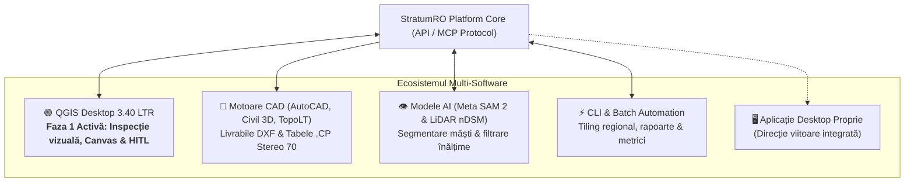

# StratumRO în QGIS: Ghid Operațional, Inspecție Canvas și Fluxul Cadastral Human-in-the-Loop (Faza 1)

**Acest document detaliază operarea curentă a platformei StratumRO în mediul QGIS Desktop, rolul QGIS în cadrul arhitecturii multi-software și protocolul de inspecție asistată uman (Human-in-the-Loop).**

---

## 1. Locul QGIS în ecosistemul StratumRO

StratumRO este conceput drept un **hub deschis de unelte geospațiale și inteligență artificială**, având ca scop conectarea inginerului geodez cu algoritmi avansați de viziune computațională și geometrie deterministă. Arhitectura generală StratumRO este proiectată să comunice cu mai multe softuri și medii inginerești:



### De ce QGIS Desktop în Faza 1?

1. **Mediul de lucru natural al geodezului**: QGIS Desktop oferă suport nativ excelent pentru proiecția națională a României (**Stereo 70 / EPSG:3844**), piramide raster de rezoluție mare (ortofotoplanuri de 5–15 cm/pixel) și baze de date spațiale deschise (GeoPackage, PostGIS, SpatiaLite).
2. **Inspecție vizuală critică (Human-in-the-Loop)**: Inteligența artificială (oricât de avansată) produce erori de segmentare pe texturi complexe (arbori peste streșini, curți betonate, acoperișuri metalice reflectorizante). QGIS servește ca „cockpit” interactiv în care operatorul uman vede instant propunerea modelului suprapusă peste ortofoto și relieful LiDAR nDSM.
3. **Nicio avizare automată fără geodez**: În conformitate cu legislația națională (Ordinul ANCPI 600/2023), nicio geometrie extrasă automat nu are valoare juridică fără verificarea, asumarea și ștampila profesională a specialistului autorizat. Faza 1 pune accentul pe această cooperare asistent AI – profesionist uman.

---

## 2. Arhitectura conexiunii StratumRO – QGIS

Integrarea dintre codul StratumRO și QGIS Desktop funcționează pe două paliere:

### A. Proiectul Master Comun de Inspecție
Toți agenții și operatorii umani lucrează pe același proiect de lucru versionat:
```text
workspace/reviews/body_recovery_20261013/inspectie_corectii.qgs
```
Acest fișier de proiect conține:
- Ortofotoplanul de bază al zonei de test (Cluj-Napoca campus).
- Rasterul LiDAR nDSM (Normalized Digital Surface Model) calculat prin $\mathrm{DSM} - \mathrm{DTM}$.
- Grupurile de straturi cadastrale delimitate pe loturi (`Lot1_Acceptat`, `Lot2`, `Lot3_Repairs`, `Lot4_Orthogonal`, `B_CORECTII_20261019`).
- Straturile de comparație și etapele de rafinare (SAM 2 brut vs regularizare ortogonală la 90°).

### B. Puntea Locală Socket MCP (Port 9876)
Pentru comunicare automată, modulul `stratum_ro/api/service.py` și bridge-ul din pluginul QGIS expun o conexiune socket pe portul `9876`:
- Permite agenților AI (Antigravity, Claude, Kilo) să interogheze starea canvas-ului QGIS (`query_qgis`).
- Comenzi de navigare automată: centrare pe un anumit ID de clădire (ex: `zoom_to_feature("B039")`).
- Captură de ecran automată a canvas-ului curent pentru audit vizual și rapoarte.
- Comutarea vizibilității straturilor pentru a compara opțiunile (ex: Opțiunea A vs Opțiunea B).

---

## 3. Ghidul Operatorului: Inspecție pas cu pas

### Pasul 1: Deschiderea proiectului și verificarea vizuală
1. Deschideți QGIS Desktop 3.40 LTR.
2. Deschideți proiectul:
   `workspace/reviews/body_recovery_20261013/inspectie_corectii.qgs`.
3. Asigurați-vă că CRS-ul proiectului (colțul din dreapta jos) este setat pe **EPSG:3844 (Dealul Piscului 1970 / Stereo 70)**.
4. Verificați că stratul de ortofoto și stratul nDSM LiDAR sunt vizibile ca fundal de referință.

### Pasul 2: Evaluarea propunerilor de geometrie ale AI-ului
Când StratumRO generează o propunere pentru un corp de clădire:
- **Masca brută SAM 2** reflectă textura optică a imaginii și poate avea margini rotunjite sau ondulate din cauza pixelilor.
- **Poligonul regularizat StratumRO** aplică algoritmul de regularizare la 90° (`stratum_ro/roof_simple_geometry.py`), transformând conturul într-o formă rectangulară curată conform practicilor cadastrale.
- **Inspecția vizuală a operatorului**:
  - *Are acoperișul corpuri fizice distincte?* (Exemplul clădirii T10: acoperișul principal din țiglă roșie este separat de corpul jos vestic din beton/tablă; acestea **nu trebuie unite** într-un singur poligon forțat).
  - *Există arbori care maschează streașina?* Dacă vegetația acoperă o parte a fațadei, verificați nDSM-ul LiDAR pentru a identifica dacă peretele continuă drept.
  - *Sunt colțurile la 90 de grade?* Se verifică dacă unghiurile sunt ortogonale sau dacă arhitectura reală impune unghiuri ascuțite/obtuze.

### Pasul 3: Inspecția la Scară 1:150 și Regularizarea Balansată
Pentru a depista erorile fine de geometrie pe care o vedere de ansamblu le ascunde:
- **Scara de inspecție obligatorie**: Se utilizează `canvas.zoomScale(150.0)` în consolă sau interfață (fereastră pe ecran de doar **44 m × 25 m**, unde 1 pixel = 3.9 cm).
- **Regulă cadastrală: Precizie > Număr mic de noduri**:
  - Nu se forțează dreptunghiuri oarbe de 4 noduri peste decroșuri în L, U, T, verande sau abside de biserică.
  - Se păstrează formele ortogonale la 90° cu 6–14 noduri (`tools/remediate_full_map_precision_first.py`).
- **Eliminarea spike-urilor și zimților**:
  - Latură minimă $\ge 1.20\text{ m}$ (eliminarea dinților de fierăstrău).
  - Niciun unghi ascuțit $< 75^\circ$; colțurile sunt 100% ortogonale la 90°.
  - Dizolvarea găurilor false provocate de umbre pe acoperișuri pline.

### Pasul 4: Aplicarea retragerilor cadastrale (streșini)
În conformitate cu normele ANCPI, amprenta la sol a clădirii diferă de conturul streșinii acoperișului:
- StratumRO aplică retragerea legală de streașină de **-0.40 m** pe conturul ortogonal complet, generând stratul oficial de parter 1CC.
- În QGIS, operatorul inspectează simultan stratul de acoperiș (linie punctată violet/portocalie) și stratul retras de parter (linie continuă).

### Pasul 5: Exportul către mediile CAD (Livrabilul Geodezic)
După ce corpurile de clădire au fost verificate pe canvas-ul QGIS, StratumRO asigură puntea către softurile CAD specifice pieței din România:

1. **Export DXF conform normelor TopoLT / ANCPI**:
   - Generat prin `stratum_ro/domain/cadastre_ro/exporter.py` sau `tools/build_dual_products.py`.
   - Poligoanele clădirilor sunt exportate pe stratul dedicat conform convenției (ex: `1CL_CONSTRUCTII`).
   - Punctele de contur sunt generate ca entități `POINT` cu atribute de număr și cotă pe stratul `PUNCTE`.
2. **Generarea fișierelor de coordonate `.cp`**:
   - Format standard de schimb cadastral pentru România, conținând:
     `Nr. Punct | Coordonata X (Nord) | Coordonata Y (Est) | Cod Punct`
   - Coordonatele sunt exprimate exclusiv în metri, cu două sau trei zecimale, în sistemul Stereo 70.
3. **Pachetul GeoPackage (.gpkg)**:
   - Păstrează atributele complete (ID unic, arie calculată, perimetru, înălțime nDSM estimată, dată generare, stare revizie).

---

## 4. Bune practici și capcane de evitat pentru agenții AI în QGIS

Când un agent AI (prin unelte CLI sau MCP) interacționează cu spațiul QGIS:

- **Nu salvați proiectul peste modificările altui agent**: Verificați dacă există un fișier de blocaj sau dacă QGIS rulează activ cu modificări nesalvate.
- **Păstrați ordinea straturilor (Render Order)**: Vectorii de clădire trebuie să stea deasupra rasterelor ortofoto și LiDAR. Dacă un contur nu se vede, verificați dacă un strat raster de detaliu nu îl acoperă (vezi `stratum_ro/qgis_render_order.py`).
- **Nu suprascrieți identificatorii existenți**: Păstrați ID-urile stabile (ex: `T10`, `T17:C1`, `T17:C2`, `B039`).
- **Nu declarați automat atributul `ADMIS`**: În cod și atribute, starea unei geometrii este `PROPOSAL`, `IN_REVIEW` sau `VERIFIED_VISUALLY`. Atributul legal de avizare aparține exclusiv procedurii oficiale ANCPI.

---

## 5. Legături utile

- [README Principal](../README.md) · [Versiunea în Română](../README.ro.md)
- [Ghidul Agenților AI](../AGENTS.md)
- [Starea curentă a loturilor și selecțiilor active](PROJECT_STATE.md)
- [Harta sistemului și diagramele de flux](SYSTEM_MAP.md)
- [Legislație cadastrală ANCPI Ordinul 600/2023](legislation_2026/ANCPI_Ordin_600_2023_2026.md)
