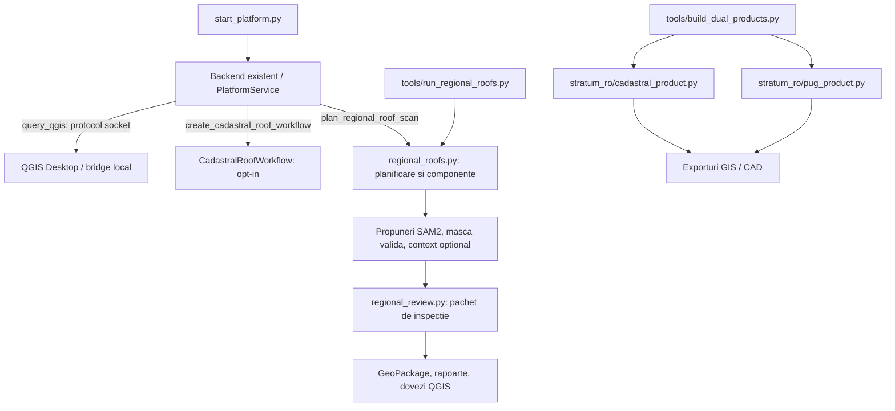
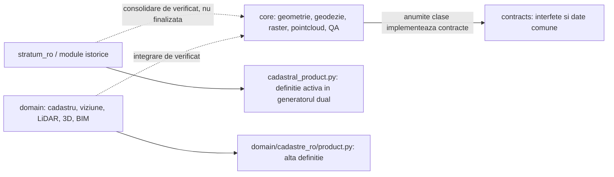
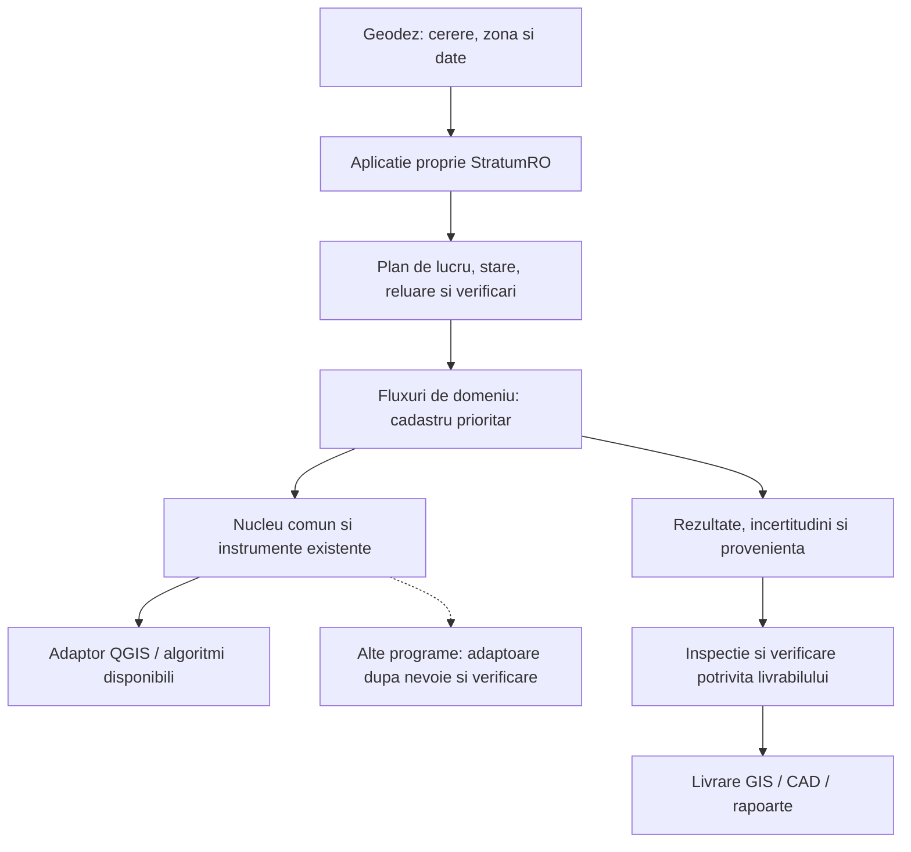
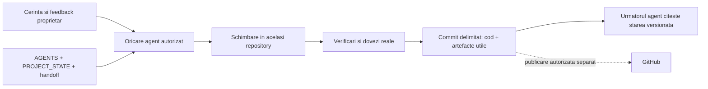

# Harta sistemului StratumRO

Verificare statică: 2026-10-18, bază locală `170407c`. Săgețile de mai jos descriu relații limitate, observabile; nu certifică execuția tuturor combinațiilor. [Indexul AST](../workspace/repository_cleanup_20261018/python_structure.json) păstrează simbolurile și importurile inspectate fără a importa modulele.

## Legături existente în cod

Dovezi: `start_platform.py`, `stratum_ro/api/service.py`, `tools/run_regional_roofs.py`, `tools/package_regional_roof_review.py` și `tools/build_dual_products.py`. Conexiunea QGIS este implementată; nu a fost probată live în auditul documentației. Fluxurile de propuneri nu sunt echivalente cu inventar validat sau cadastru final.

## Structură existentă, cu migrare incompletă

Integrare ulterioară verificată la 2026-10-18: `vector.refine_regional_roofs` → wrapperul din `ai/tools/vector_tools.py` → `PlatformService.create_regional_roof_refiner` → `regional_refinement.RegionalRoofRefiner`, același motor apelat de `tools/refine_regional_roofs.py`. Reutilizează mozaicul, deduplicarea și fitterele existente. Rafinarea SAM2 este opt-in și verificată pe patru propuneri, nu o nouă inferență pe întreaga zonă. [Dovezi, limite și diagramă](../workspace/option_b_refinement_20261018/README.md). Înregistrarea uneltei a fost verificată; procesele MCP active necesită reîncărcare pentru a descoperi intrarea nouă.

Aceste directoare există. Nu declarăm din diagramă că toate modulele de domeniu apelează core-ul sau că vechile definiții sunt simple aliasuri. Punctele de duplicare și contractele absente sunt consemnate în [PROJECT_STATE.md](PROJECT_STATE.md).

## Direcția produsului — planificată, nu livrată integral

Reutilizarea QGIS este intenționată. Interfața proprie, backendul și aplicațiile conectate pot avea procese diferite; aceasta nu diminuează identitatea StratumRO. Alegerea unui ambalaj `.exe` nu cere rescrierea algoritmilor. O eventuală componentă Rust se justifică printr-un blocaj măsurat și compatibilitate verificată, într-o etapă distinctă.

Hugging Face poate furniza modele cu versiune/licență fixate sau un backend opțional aprobat. Nu este o legătură obligatorie a acestei arhitecturi și nu garantează automat calitatea contururilor.

## Traseul dovezilor și al agenților

Documentele partajate transferă criterii și stare verificabilă. Nu transferă automat conversațiile sau raționamentul intern și nu asigură coordonare concurentă prin simpla lor existență.

Diagramele folosesc [Mermaid acceptat de GitHub](https://docs.github.com/en/get-started/writing-on-github/working-with-advanced-formatting/creating-diagrams). Formatul lor este text versionat; nu depind de un serviciu extern de desenare.
