# STRATUMRO — CURRENT VS. TARGET ARCHITECTURE

**Document Type:** Architecture / Forensic Gap Audit  
**Project:** StratumRO  
**Repository:** `https://github.com/lefterpatrickandrei-sketch/StratumRO-QGIS`  
**Commit:** `c976864` (Branch: `main`)  
**Audit Standard:** Strict Forensic Mode (Analysis Only — Zero Code Modification)  
**Date:** 2026-09-20  

---

## 1. EXECUTIVE SUMMARY

This document provides a comparative gap analysis between the **Current Implementation Reality** of the StratumRO repository and the **Target High-Level Architecture** defined in the Master Audit Specification.

```text
CURRENT REALITY (Phase 1–4 Slices) ───[ GAPS & BRIDGES ]───> TARGET PLATFORM ARCHITECTURE
• 1 monolithic PyQGIS dockwidget                              • Modular Client Layer (QGIS, Web, CLI, API)
• Flat stratum_ro/ domain modules                             • 13 Distinct Pluggable Domain Packs
• Hardcoded Cluj sensor paths in config                       • Dynamic Dataset & Sensor Abstraction
• Universal math mixed with Romanian Cadastre                 • Universal Reusable CORE Engine
• E0–E9 experiments as standalone scripts                     • Systematic Experiment & Simulation Engine
```

> **The Fundamental Operating Principle:**  
> `CURRENT IMPLEMENTATION ≠ TARGET PLATFORM`  
> A design concept is not implemented merely because it is described in documentation. A capability is classified as `OPERATIONAL` only if importable code exists on disk and executes cleanly under automated test coverage.

---

## 2. THE CURRENT ARCHITECTURE REALITY

Today, StratumRO is structured as a rich, working geomatics system with strong algorithmic capabilities, organized across five primary physical areas:

```text
CURRENT CODEBASE STRUCTURE
│
├── stratum_ro/                 # Primary Python package & QGIS Plugin
│   ├── ai/                     # Phase 4 Adaptive AI Core (TaskSpec, Risk, Provenance, ClosedLoop)
│   ├── api/                    # FastAPI Backend Server & PlatformService
│   ├── web/                    # Dark Luxury Web Cockpit (HTML5 / Leaflet)
│   ├── simulation/             # PerturbationEngine (Controlled geometry stress testing)
│   ├── test/                   # 214 Unit tests (205 passed, 9 skipped, 0 failed)
│   └── *.py (28 root files)    # Core geodetic algorithms & ANCPI cadastral logic (flat layout)
│
├── engine/                     # Geodetic evaluation metrics & formal ablation studies
│
├── mcp/                        # FastMCP Server exposing 21 deterministic tools to AI agents
│
├── tools/                      # 65 operational scripts (Cluj experiments, spectator QGIS projects)
│
└── data/ & workspace/          # Authoritative ground truth & generated cadastral evidence
```

### Current Strengths:
1. **100% Deterministic Geodesy**: All spatial transformations, Helmert adjustments, 90° CAD orthogonalization, eave retraction offsets, polygon areas, and PAD coordinate tables run exclusively through deterministic Python/GEOS/GDAL math. Zero LLM hallucinations.
2. **Operational QGIS Bridge**: A live TCP socket bridge (`127.0.0.1:9876`) connects external processes (FastAPI, CLI tools, AI agents) to active QGIS Desktop 3.40 sessions without binary conflicts.
3. **Comprehensive Test Suite**: 214 tests discoverable with zero failures, guaranteeing stability during non-destructive audits.

---

## 3. THE TARGET ARCHITECTURE FRAMEWORK

The platform's future architecture is organized into 9 clear, decoupled layers:

```text
STRATUMRO (TARGET PLATFORM)
│
├── CORE                        # Universal geospatial/scientific infrastructure
│   ├── data                    # Universal Common Geospatial Object & Typed Datasets
│   ├── CRS / transformations   # Deterministic coordinate transformations & vertical datums
│   ├── geometry                # Topology, polygonization, simplification, clipping
│   ├── geodesy                 # Ellipsoids, geoids, cartographic projections
│   ├── corrections             # Systematic sensor corrections, atmospheric, geometric
│   ├── adjustment              # Least Squares Adjustment, Helmert 2D/3D, Procrustes
│   ├── uncertainty             # Covariance propagation, confidence intervals, error bounds
│   ├── simulation              # Sensor simulation, Monte Carlo stress testing, synthetic AOIs
│   ├── validation              # L0–L5 Geodetic Validation Pipeline & Quality Gates
│   ├── provenance              # Immutable Lineage DAGs & digital surveyor signatures
│   ├── workflow                # TaskGraph, TaskSpec, execution pipelines
│   ├── capability              # Pluggable Capability Registry & provider matching
│   ├── execution               # Parallel execution engine, resource snapshots, sandboxing
│   └── governance / security   # Least-privilege risk policies, secret redaction, freeze locks
│
├── AI                          # Intelligence & Orchestration Plane
│   ├── providers               # Provider adapters: NVIDIA NIM, OpenRouter, OpenAI, Local
│   ├── models                  # Model wrappers: Meta SAM 2 Hiera, VLM, Nemotron
│   ├── routing                 # Intelligent task-to-capability routing with deterministic bypass
│   ├── vision                  # Optical segmentation, mask fusion, visual QA inspection
│   ├── reasoning               # Multi-file architectural reasoning & geodetic code audits
│   └── agents                  # Specialized agent personas (Antigravity developer, Kilo reviewer)
│
├── DOMAIN PACKS                # Specialized Geospatial Knowledge & Specialized Algorithms
│   ├── Geodesy                 # High-precision datum transformations, gravimetry
│   ├── Topography              # Total station traverse, tachymetry, contour generation
│   ├── Cadastre                # ANCPI Ordinul 600/2023, TopoLT DXF, .CP files, PAD tables
│   ├── Photogrammetry          # Bundle adjustment, camera calibration, epipolar geometry
│   ├── LiDAR                   # Ground classification (CSF/SMRF), height normalization, nDSM
│   ├── Remote Sensing          # Multispectral indices (NDVI, ExG, NDWI), change detection
│   ├── GIS                     # Spatial analysis, network analysis, map overlay
│   ├── Cartography             # Symbology, labeling, sheet layouts, atlas generation
│   ├── GNSS                    # RTK, PPK, RINEX parsing, ambiguity resolution
│   ├── 3D / City / BIM         # LoD1/LoD2 extrusion, CityJSON v1.1, IFC/BIM interoperability
│   ├── Urbanism                # PUG regulation checks, setback buffers, zoning compliance
│   ├── Hydrography             # Flow direction, watershed delineation, flood simulation
│   └── Deformation / Monitoring# Displacement vectors, interferometry, subsidence analysis
│
├── CLIENTS                     # Surface Interfaces
│   ├── QGIS                    # QGIS Plugin (thin UI), Processing Algorithms, Layer Viewers
│   ├── Web                     # StratumRO Web Cockpit (Dark Luxury Geomatics SPA)
│   ├── CLI                     # Command-line tools, batch runners, headless orchestrator
│   └── API                     # FastAPI REST endpoints, SSE telemetry streams, WebSockets
│
├── MCP                         # Model Context Protocol Tool Gateway
├── DATA                        # Multi-sensor datasets, frozen ground truth, benchmarks
├── WORKFLOWS                   # Declarative pipeline recipes uniting capabilities across domains
├── MODELS                      # Local model weights, ONNX graphs, execution profiles
└── DOCS                        # Architecture specifications, evidence matrices, audit logs
```

---

## 4. COMPREHENSIVE LAYER-BY-LAYER GAP ANALYSIS

| Target Layer | Current Implementation on Disk | Architectural Gap / Deficiency | Target Architecture Requirement |
| :--- | :--- | :--- | :--- |
| **CORE / data** | `dataset_resolver.py` resolves files via hardcoded user paths. | No abstract `GeoDataset` interface. Data is passed as raw Shapely objects or GeoPandas DataFrames. | Universal Common Geospatial Object encapsulating raster/vector with metadata and CRS. |
| **CORE / CRS** | `pyproj.Transformer` in `api/service.py` & `dataset_resolver.py`. | CRS logic duplicated across multiple scripts; EPSG codes hardcoded in various tools. | Centralized `CrsRegistry` supporting epoch-aware transformations and vertical datums. |
| **CORE / geometry** | Generic functions inside `vectorizer.py` and `geometry_utils.py`. | Generic smoothing and clipping are tightly coupled with Romanian cadastral eave offsets. | Pure mathematical geometry library independent of any domain regulation. |
| **CORE / geodesy** | Helmert 2D adjustment in `engine/evaluation.py`. | Ellipsoidal geodesy and geoid undulations not generalized. | Reusable geodetic adjustment module (Helmert, Affine, Least Squares). |
| **CORE / uncertainty**| Wilson score 95% CI and RMSE in `evaluation.py`. | Statistical uncertainty does not propagate through multi-stage vector operations. | Full covariance propagation and boundary spatial uncertainty modeling. |
| **CORE / simulation** | `simulation/perturbation.py` (jitter, scale, rotation). | Limited to 2D polygon noise; lacks synthetic point cloud beam simulation. | Comprehensive sensor noise simulation and parameter sweep framework. |
| **CORE / validation** | `ai/data_profiler.py` (L0–L5 pipeline) & `evaluation.py`. | Functional on benchmarks, but requires formal integration with all domain outputs. | Universal multi-level Quality Gate verifying every workflow deliverable. |
| **CORE / provenance** | `ai/provenance.py` (ProvenanceChain with 8 classes). | Implemented in Phase 4 slice; needs adoption across all 65 legacy tools. | W3C PROV-compliant cryptographic lineage attached to every output product. |
| **CORE / workflow** | `ai/task_graph.py` & `ai/task_spec.py`. | Directed graph implemented; needs declarative YAML workflow loader. | Dynamic DAG orchestrator supporting parallel execution and state pause/resume. |
| **CORE / capability**| `ai/registry.py` with deterministic bypass. | Capabilities manually registered; needs auto-discovery via Python entry points. | Universal capability discovery engine with automated fallback mechanisms. |
| **CORE / governance**| `ai/risk.py` least-privilege engine. | Immutability lock and secret scrubbing active; requires external audit trail logging. | System-wide risk engine enforcing policy across CLI, API, and QGIS clients. |
| **AI / providers** | `ai/providers/` (NIM, OpenRouter, OpenAI, Local). | Working and tested live; needs automatic latency-based fallback routing. | Provider-agnostic gateway with real-time health checks and cost tracking. |
| **AI / vision** | `sam2_engine.py`, `onnx_engine.py`, `vlm_verifier.py`.| SAM 2 and NVIDIA NIM functional; prompt generation requires dense adaptive grid. | Vision pipeline abstracting optical segmentation from specific model backends. |
| **DOMAIN PACKS** | Implemented as flat files in `stratum_ro/` (`cad_exporter.py`, etc.). | Not organized as pluggable packs; tight coupling with root package namespace. | Pluggable Domain Pack structure (`domain_cadastre`, `domain_lidar`, `domain_3d`). |
| **CLIENTS / QGIS** | `stratum_ro_dockwidget.py` (1300 lines monolithic UI). | UI contains business logic, thread spawning, and direct backend calls. | Thin QGIS client invoking platform capabilities via `TaskSpec` and local API/MCP. |
| **CLIENTS / Web** | `stratum_ro/web/` (Dark Luxury Geomatics Web Cockpit). | Functional Leaflet SPA; needs tile streaming for large rasters and 3D viewer. | Production-grade Geomatics Web Cockpit with live QGIS mirror and 3D CityJSON. |
| **CLIENTS / API** | `stratum_ro/api/app.py` (FastAPI). | Functional REST/SSE endpoints; needs WebSocket stream for real-time task logs. | High-performance asynchronous API gateway serving web, desktop, and CLI clients. |

---

## 5. CORE CANDIDATES: UNIVERSAL VS. DOMAIN VS. CASE-SPECIFIC

A fundamental requirement of the audit is to cleanly separate universal platform capabilities from domain specializations and case-study demonstrators:

```text
┌────────────────────────────────────────────────────────────────────────┐
│                        STRATUMRO CORE (UNIVERSAL)                      │
│  • CRS Transformations (EPSG:3844 <-> EPSG:4326)                       │
│  • Geodetic Evaluation Metrics (IoU, Hausdorff, Boundary RMSE, Wilson) │
│  • L0–L5 Validation Profiler (Spatial Consistency, Envelope Check)     │
│  • Geometric Primitives (OBB, Collinear Vertex Elimination, RDP)      │
│  • Immutable Provenance Chain & Surveyor Sign-Off Signatures          │
│  • Least-Privilege Risk Engine (Ground Truth Immutability Lock)        │
│  • Capability Registry & Deterministic Math Bypass                     │
│  • Perturbation & Stress Simulation Engine                             │
│  • TaskSpec & Directed Acyclic Graph (TaskGraph) Execution             │
└───────────────────────────────────┬────────────────────────────────────┘
                                    │
        ┌───────────────────────────┴───────────────────────────┐
        ▼                                                       ▼
┌──────────────────────────────┐        ┌──────────────────────────────┐
│         DOMAIN PACKS         │        │    CASE-STUDY DEMONSTRATOR   │
│  • Cadastre (ANCPI Ord. 600) │        │        (CLUJ–USAMV)          │
│  • TopoLT DXF, .CP, PAD Table│        │  • 500m x 400m Campus AOI    │
│  • LiDAR Ground Filtering    │        │  • 0.20m Cluj Orthophoto     │
│  • nDSM Height Normalization │        │  • Airborne LAZ Point Cloud  │
│  • ExG Vegetation Filtering  │        │  • DTM 3m Elevation Raster   │
│  • 3D LoD1 CityJSON Extrusion│        │  • Tier 1 (29 Bldgs) GT      │
│  • PUG Urbanism Regulation   │        │  • Tier 2 (150 Bldgs) GT     │
└──────────────────────────────┘        │  • E0–E9 Experiment Harness  │
                                        └──────────────────────────────┘
```

---

## 6. EXECUTION-MODE ARCHITECTURE

The platform targets 3 execution modes, each with distinct interaction patterns and safety gates:

```mermaid
graph TD
    subgraph Mode1 ["1. HUMAN ONLY MODE"]
        H1["User selects input data & AOI"] --> H2["User chooses deterministic algorithm"]
        H2 --> H3["Deterministic Core Engine executes"]
        H3 --> H4["User visually inspects deliverable in QGIS / Web"]
        H4 --> H5["Human signs off (Mandatory Legal Cadastre)"]
    end

    subgraph Mode2 ["2. HYBRID (HUMAN + AI) MODE — Current Operational Mode"]
        Y1["User / Context provides AOI"] --> Y2["AI analyzes raster & LiDAR heights"]
        Y2 --> Y3["AI proposes workflow & prompt candidates"]
        Y3 --> Y4["Human approves or adjusts bounding boxes"]
        Y4 --> Y5["Deterministic engine performs 90° CAD regularization"]
        Y5 --> Y6["VLM (Llama 3.2 Vision) checks for anomalies"]
        Y6 --> Y7["Licensed Surveyor validates & signs off PAD/.CP"]
    end

    subgraph Mode3 ["3. AUTONOMOUS AI MODE — Research & Batch Quality Gate"]
        A1["Objective: 'Evaluate compliance of AOI candidates'"] --> A2["AI plans TaskGraph via CapabilityRegistry"]
        A2 --> A3["RiskEngine checks permissions (DENY on Ground Truth)"]
        A3 --> A4["Deterministic Core runs L0-L4 DataProfiler & Metrics"]
        A4 --> A5["PerturbationEngine runs stress simulation"]
        A5 --> A6["ProvenanceChain stamps immutable audit log"]
        A6 --> A7["Deliverables generated; Human review flagged if RMSE > threshold"]
    end
```



---

## 7. EVOLUTION OF CLUJ–USAMV: FROM AD-HOC SCRIPT TO MULTIDOMAIN DEMONSTRATOR

The audit firmly rejects the idea of treating Cluj–USAMV as obsolete or disposable code. Instead, Cluj–USAMV must be understood and preserved as:

> **The First Integrated Multidomain Demonstrator of StratumRO.**

### Multidomain Convergence in Cluj–USAMV:
1. **Photogrammetry**: 0.20m GSD optical orthophoto chip extraction, radiometric balance, windowed VRT reading.
2. **LiDAR**: Airborne LAZ point cloud ingestion, ASPRS Class 2 (ground) and Class 6 (building) separation, DTM interpolation, nDSM height normalization.
3. **Computer Vision / AI**: Meta SAM 2 Hiera neural network segmentation, nDSM height prompting, morphological closing, multi-scale adjacency graph fusion.
4. **Geodesy**: Official Romania Stereo 70 (`EPSG:3844`) cartographic projection, Black Sea 1975 (`EPSG:5781`) vertical altimetry.
5. **Geometry & Topology**: 90° orthogonal regularization, principal facade rotation, collinear vertex elimination, planar gap-free partitioning.
6. **Cadastre**: TopoLT CAD standard layer separation (`1CC`, `2CC`, `CP`, `VARFURI`, `NUMERE_PCT`), automated PAD coordinate table drawing, official `.CP` interchange format.
7. **3D / BIM**: True 3D LoD1 solid block extrusion (`MultiPolygonZ`), RANSAC 3D roof plane segmentation, OGC CityJSON v1.1 export.
8. **QA/QC & Evidence**: Rigorous PASCAL VOC IoU matching, 95th percentile Hausdorff distance, Boundary RMSE, Wilson confidence intervals, and automated Kilo adversarial review.

By keeping Cluj–USAMV intact as an integrated testbed, StratumRO proves that its modular platform architecture can successfully solve a complex, real-world geospatial problem before generalizing to new geographic areas and domains.
