# STRATUMRO — DEPENDENCY MAP

**Document Type:** Architecture / Forensic Dependency Audit  
**Project:** StratumRO  
**Repository:** `https://github.com/lefterpatrickandrei-sketch/StratumRO-QGIS`  
**Commit:** `c976864` (Branch: `main`)  
**Audit Standard:** Strict Forensic Mode (Analysis Only — Zero Code Modification)  
**Date:** 2026-09-20  

---

## 1. EXECUTIVE SUMMARY

This document maps all internal module relationships, external package dependencies, PyQGIS runtime bindings, dependency cycles, and operating system assumptions across the StratumRO repository.

### Key Dependency Findings:
1. **Clean Pure-Python Core**: The core mathematical and geodetic algorithms ([`vectorizer.py`](file:///c:/Users/lefpa/Downloads/QGIS-AI/stratum_ro/vectorizer.py), [`cad_exporter.py`](file:///c:/Users/lefpa/Downloads/QGIS-AI/stratum_ro/cad_exporter.py), [`volumetric_3d.py`](file:///c:/Users/lefpa/Downloads/QGIS-AI/stratum_ro/volumetric_3d.py), [`engine/evaluation.py`](file:///c:/Users/lefpa/Downloads/QGIS-AI/engine/evaluation.py), and [`stratum_ro/ai/`](file:///c:/Users/lefpa/Downloads/QGIS-AI/stratum_ro/ai/)) have **zero dependency on PyQGIS**. They execute cleanly in any standard Python 3.10+ virtual environment.
2. **Strict QGIS Isolation via Socket**: The new FastAPI backend ([`stratum_ro/api/`](file:///c:/Users/lefpa/Downloads/QGIS-AI/stratum_ro/api/)) and closed-loop orchestrator ([`stratum_ro/ai/closed_loop.py`](file:///c:/Users/lefpa/Downloads/QGIS-AI/stratum_ro/ai/closed_loop.py)) communicate with QGIS Desktop exclusively through an out-of-process **TCP wire socket (`127.0.0.1:9876`)**, completely eliminating Python DLL/ABI conflicts.
3. **Monolithic Inversion of Control in DockWidget**: The QGIS plugin GUI ([`stratum_ro_dockwidget.py`](file:///c:/Users/lefpa/Downloads/QGIS-AI/stratum_ro/stratum_ro_dockwidget.py)) directly imports almost all backend modules (`sam2_engine`, `vectorizer`, `cad_exporter`, `dataset_resolver`, `logic_handler`), creating tight coupling between the UI client and domain algorithms.

---

## 2. INTERNAL MODULE DEPENDENCY GRAPH

```mermaid
graph TD
    subgraph Clients ["CLIENTS LAYER"]
        DockWidget["stratum_ro_dockwidget.py (PyQGIS GUI)"]
        Plugin["stratum_ro.py (Plugin Lifecycle)"]
        ProcAlgorithm["cadastral_algorithm.py (QGIS Processing)"]
        ProcProvider["processing_provider.py (Provider Registry)"]
        FastAPIApp["stratum_ro/api/app.py (REST / SSE)"]
        WebCockpit["stratum_ro/web/ (HTML5 / Leaflet)"]
        Launcher["start_platform.py"]
    end

    subgraph MCPGateway ["MCP TOOL LAYER"]
        FastMCPServer["mcp/stratumro_server.py"]
        AITools["stratum_ro/ai/tools/ (*_tools.py)"]
    end

    subgraph AICore ["AI CONTROL PLANE"]
        ClosedLoop["stratum_ro/ai/closed_loop.py"]
        AIRouter["stratum_ro/ai/router.py"]
        CapabilityReg["stratum_ro/ai/registry.py"]
        TaskGraph["stratum_ro/ai/task_graph.py"]
        TaskSpec["stratum_ro/ai/task_spec.py"]
        ContextEng["stratum_ro/ai/context.py"]
        DataProfiler["stratum_ro/ai/data_profiler.py"]
        RiskEng["stratum_ro/ai/risk.py"]
        Provenance["stratum_ro/ai/provenance.py"]
        Providers["stratum_ro/ai/providers/ (NIM, OpenRouter, OpenAI, Local)"]
        VLMVerifier["stratum_ro/ai/vlm_verifier.py"]
    end

    subgraph DomainAlgorithms ["DOMAIN CAPABILITIES LAYER"]
        Vectorizer["stratum_ro/vectorizer.py (90° Regularization)"]
        CadExporter["stratum_ro/cad_exporter.py (TopoLT, PAD, .CP)"]
        Volumetric3D["stratum_ro/volumetric_3d.py (LoD1 CityJSON)"]
        LidarProc["stratum_ro/lidar_processor.py (nDSM, Laspy)"]
        OrthoExtr["stratum_ro/ortho_extractor.py (VRT/TIFF)"]
        VegFilter["stratum_ro/vegetation_filter.py (ExG)"]
        Orientation["stratum_ro/orientation_regularizer.py (Facade 90°)"]
        CadProduct["stratum_ro/cadastral_product.py"]
        Landuse["stratum_ro/landuse_ancpi.py"]
        SAM2Engine["stratum_ro/sam2_engine.py"]
        ONNXEngine["stratum_ro/onnx_engine.py"]
        PromptGen["stratum_ro/prompt_generator.py"]
        MaskFusion["stratum_ro/mask_fusion.py"]
    end

    subgraph CoreEngine ["CORE PLATFORM & EVALUATION"]
        PlatformService["stratum_ro/api/service.py"]
        DatasetResolver["stratum_ro/dataset_resolver.py"]
        Evaluation["engine/evaluation.py"]
        Ablation["engine/ablation_study.py"]
        Perturbation["stratum_ro/simulation/perturbation.py"]
        GeomUtils["stratum_ro/geometry_utils.py"]
    end

    %% Client Invocations
    DockWidget --> Vectorizer
    DockWidget --> CadExporter
    DockWidget --> SAM2Engine
    DockWidget --> DatasetResolver
    DockWidget --> LidarProc
    Plugin --> DockWidget
    ProcAlgorithm --> Vectorizer
    ProcAlgorithm --> CadExporter
    ProcProvider --> ProcAlgorithm
    Launcher --> FastAPIApp
    WebCockpit <-->|HTTP / SSE| FastAPIApp
    FastAPIApp --> PlatformService
    FastAPIApp --> ClosedLoop
    PlatformService <-->|TCP Socket 9876| LiveQGIS["QGIS Desktop 3.40 (Live Instance)"]

    %% MCP Gateway
    FastMCPServer --> AITools
    AITools --> Vectorizer
    AITools --> CadExporter
    AITools --> Volumetric3D
    AITools --> LidarProc
    AITools --> SAM2Engine
    AITools --> Evaluation

    %% AI Core Invocations
    ClosedLoop --> Providers
    ClosedLoop --> LiveQGIS
    AIRouter --> CapabilityReg
    CapabilityReg --> Providers
    CapabilityReg --> Vectorizer
    TaskGraph --> TaskSpec
    TaskGraph --> ContextEng
    TaskGraph --> DataProfiler
    TaskGraph --> RiskEng
    TaskGraph --> Provenance

    %% Domain Cross-Calls
    SAM2Engine --> ONNXEngine
    Vectorizer --> Orientation
    Vectorizer --> GeomUtils
    MaskFusion --> GeomUtils
    Volumetric3D --> GeomUtils

    %% Core Cross-Calls
    Ablation --> Evaluation
```

---

## 3. EXTERNAL DEPENDENCIES INVENTORY

The project dependencies defined in [`requirements.txt`](file:///c:/Users/lefpa/Downloads/QGIS-AI/requirements.txt) and verified in runtime:

| Package | Version Spec | Actual Installed Version | Category | Purpose in Codebase | Import Locations |
| :--- | :--- | :--- | :--- | :--- | :--- |
| `shapely` | `>=2.0.1` | `2.0.7` (GEOS 3.11.4) | Geospatial Math | 2D Geometry primitives, buffer, union, intersection, OBB | `vectorizer.py`, `cad_exporter.py`, `evaluation.py`, `api/service.py` |
| `geopandas` | `>=0.13.0` | `0.14.4` | Spatial DataFrames | Reading/writing GeoPackage, spatial overlay | `cadastral_product.py`, `tools/*.py` |
| `rasterio` | `>=1.3.8` | `1.4.3` (GDAL 3.9.3) | Raster I/O | Windowed orthophoto reading, VRT reading, GeoTIFF creation | `ortho_extractor.py`, `vegetation_filter.py`, `dataset_resolver.py` |
| `laspy` | `>=2.4.1` | `2.5.4` (lazrs active) | Point Cloud I/O | ASPRS Class 2/6 LiDAR reading, height normalization | `lidar_processor.py`, `lidar_quality_gate.py`, `dataset_resolver.py` |
| `torch` | `>=2.0.0` | `2.4.1+cpu` / DirectML | Deep Learning | SAM 2 Hiera neural network inference | `sam2_engine.py`, `export_sam2_to_onnx.py` |
| `onnxruntime` | `>=1.15.0` | `1.20.1` | Neural Inference | Hardware-accelerated inference via DirectML / CPU | `onnx_engine.py`, `sam2_engine.py` |
| `ezdxf` | `>=1.1.0` | `1.3.4` | CAD Generation | TopoLT DXF standard export (`1CC`, `2CC`, `CP`, `VARFURI`) | `cad_exporter.py`, `tools/*.py` |
| `buildingregulariser`| `>=0.0.8` | `0.0.8` | CAD Regularization | Benchmark baseline for 90° orthogonalization | `vectorizer.py`, `engine/ablation_study.py` |
| `scipy` | `>=1.10.0` | `1.14.1` | Scientific Math | Delaunay triangulation, morphological filtering, distance transforms | `candidate_generator.py`, `evaluation.py`, `lidar_processor.py` |
| `numpy` | `>=1.24.0` | `1.26.4` | Numerical Arrays | Matrix math, raster grids, coordinate array transformations | Ubiquitous across all domain and engine files |
| `pillow` | `>=10.0.0` | `10.4.0` | Image Processing | Orthophoto chip JPEG/PNG encoding for VLM | `vlm_verifier.py`, `tools/*.py` |
| `pyyaml` | `>=6.0` | `6.0.2` | Configuration | Reading and parsing `config.yaml` | `dataset_resolver.py`, `ai/context.py` |
| `pyproj` | Unpinned | `3.6.1` (PROJ 9.4.1) | Geodesy / CRS | Stereo 70 (`EPSG:3844`) <-> WGS84 (`EPSG:4326`) transformers | `api/service.py`, `ai/data_profiler.py` |
| `fastapi` | `>=0.100.0` | `0.141.1` | Web API | REST endpoints, SSE streams, deliverable exports | `stratum_ro/api/app.py` |
| `uvicorn` | `>=0.22.0` | `0.34.0` | ASGI Server | Hosting FastAPI backend engine on port 8000 | `start_platform.py`, `api/app.py` |
| `pydantic` | `>=2.0` | `2.13.4` | Data Validation | Request/response models, typed configurations | `api/app.py`, `ai/task_spec.py` |
| `requests` | `>=2.31.0` | `2.32.3` | HTTP Client | Calling NVIDIA NIM, OpenRouter, and external LLMs | `ai/providers/*.py`, `vlm_verifier.py` |
| `fastmcp` | `>=0.1.0` | `0.1.0` | MCP Protocol | Exposing 21 StratumRO tools via Model Context Protocol | `mcp/stratumro_server.py` |

---

## 4. PYQGIS RUNTIME DEPENDENCY ANALYSIS

The codebase has been analyzed using AST import inspection to determine runtime isolation:

### Class A: QGIS Desktop GUI Only (Strictly requires running QGIS 3.x Application Context)
* **Modules**:
  - [`stratum_ro/stratum_ro_dockwidget.py`](file:///c:/Users/lefpa/Downloads/QGIS-AI/stratum_ro/stratum_ro_dockwidget.py) (uses `qgis.core`, `qgis.gui`, `QgsMapCanvas`, `PyQt5.QtWidgets`)
  - [`stratum_ro/stratum_ro.py`](file:///c:/Users/lefpa/Downloads/QGIS-AI/stratum_ro/stratum_ro.py) (uses `qgis.gui.QgisInterface`, `QAction`, `QMenu`)
  - [`stratum_ro/stratum_ro_dockwidget_base.py`](file:///c:/Users/lefpa/Downloads/QGIS-AI/stratum_ro/stratum_ro_dockwidget_base.py) (PyQt UI definition)
* **Execution Boundary**: Cannot be imported in standalone Python virtualenv without `import qgis` raising `ModuleNotFoundError`.
* **Test Isolation**: 9 unit tests in `stratum_ro/test/` explicitly guard against this with `@unittest.skipIf(not HAS_QGIS, ...)`.

### Class B: Headless QGIS Processing Engine (Requires QgsApplication, but no GUI)
* **Modules**:
  - [`stratum_ro/processing_provider.py`](file:///c:/Users/lefpa/Downloads/QGIS-AI/stratum_ro/processing_provider.py) (`QgsProcessingProvider`)
  - [`stratum_ro/cadastral_algorithm.py`](file:///c:/Users/lefpa/Downloads/QGIS-AI/stratum_ro/cadastral_algorithm.py) (`QgsProcessingAlgorithm`, `QgsProcessingParameterRasterLayer`)
  - `tools/build_cluj_qgis_project.py`, `tools/create_qgis_project.py`
* **Execution Boundary**: Executable via `qgis_process run` or Python scripts launched with OSGeo4W Python runtime.

### Class C: Pure Python / Autonomous Core (Zero QGIS Dependencies)
* **Modules**:
  - `stratum_ro/vectorizer.py`
  - `stratum_ro/cad_exporter.py`
  - `stratum_ro/volumetric_3d.py`
  - `stratum_ro/lidar_processor.py`
  - `stratum_ro/vegetation_filter.py`
  - `stratum_ro/sam2_engine.py`
  - `stratum_ro/onnx_engine.py`
  - `stratum_ro/dataset_resolver.py`
  - `engine/evaluation.py`
  - `engine/ablation_study.py`
  - `stratum_ro/ai/*` (all 34 modules)
  - `stratum_ro/api/*` (app.py, service.py)
  - `stratum_ro/simulation/*`
* **Execution Boundary**: Runs 100% cleanly in standard virtual environments, CI/CD runners (Ubuntu/Windows), Docker, or cloud headless environments. **205 out of 214 tests** execute in this mode.

### Class D: Out-of-Process Socket Bridge (Communicates across process boundaries)
* **Modules**:
  - `stratum_ro/api/service.py` (queries QGIS via TCP `127.0.0.1:9876`)
  - `stratum_ro/ai/closed_loop.py` (probes QGIS socket)
  - `stratum_ro/ai/context.py` (`check_qgis_mcp_socket()`)
  - `tools/capture_qgis_live_canvas.py`
* **Execution Boundary**: Connects any Python runtime to a live QGIS instance without sharing process memory.

---

## 5. DEPENDENCY CYCLES & COUPLING ANOMALIES

### 1. Client -> Domain Direct Coupling (Inversion Needed)
* **Observation**: [`stratum_ro_dockwidget.py`](file:///c:/Users/lefpa/Downloads/QGIS-AI/stratum_ro/stratum_ro_dockwidget.py) directly imports `CadastralVectorizer`, `CadastralExporter`, and `SAM2Engine`.
* **Risk**: High. Any change to the domain algorithm API requires touching the 1300-line PyQt UI file.
* **Target Resolution**: UI should invoke capabilities through the `TaskSpec` and `CapabilityRegistry` or through the `FastAPI / FastMCP` service interface.

### 2. Universal Geometry vs Cadastral Coupling
* **Observation**: [`vectorizer.py`](file:///c:/Users/lefpa/Downloads/QGIS-AI/stratum_ro/vectorizer.py) contains both generic geometric algorithms (`orthogonalize_rectangle`, `filter_spikes`, `douglas_peucker`) and cadastral ANCPI business rules (`apply_eave_offset`, `1CC`, `2CC`).
* **Risk**: Critical. Modifying a generic geometric smoothing function risks altering cadastral legal compliance.
* **Target Resolution**: Split into `CORE / geometry` (pure math) and `DOMAIN / cadastre` (cadastral policies, destination codes, eave offsets).

### 3. Circular Import Prevention in AI Subsystem
* **Observation**: `task_graph.py` and `context.py` have shared type dependencies with `task_spec.py`.
* **Resolution**: Strict layering was enforced in Phase 4 slices (P4.1–P4.6): `task_spec.py` defines leaf dataclasses with zero imports from `context.py` or `router.py`, preventing import cycles.

---

## 6. WINDOWS 11 & LOCAL ENVIRONMENT ASSUMPTIONS

1. **Path Separators**: Certain scripts use Windows backslashes (`C:\...`). While Python's `pathlib.Path` handles cross-platform conversions, hardcoded strings in `config.yaml` (`C:/Users/lefpa/Desktop/date/...`) must be parameterized with environment variable overrides (`STRATUMRO_LIDAR_LAZ`).
2. **DirectML Acceleration**: `onnx_engine.py` is configured with DirectML execution provider (`DmlExecutionProvider`), which binds to DirectX 12 on Windows. On Linux/CI, it automatically and safely falls back to multithreaded CPU execution (`CPUExecutionProvider`).
3. **Encoding**: Romanian UTF-8 cadastral characters (ș, ț, ă, î, â) in layer names previously conflicted with Windows console `cp1252`. All network and file handlers now strictly enforce `utf-8`.
