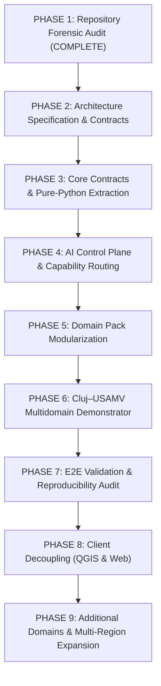

# STRATUMRO — MIGRATION RISK REGISTER & ROADMAP

**Document Type:** Architecture / Forensic Risk Register  
**Project:** StratumRO  
**Repository:** `https://github.com/lefterpatrickandrei-sketch/StratumRO-QGIS`  
**Commit:** `c976864` (Branch: `main`)  
**Audit Standard:** Strict Forensic Mode (Analysis Only — Zero Code Modification)  
**Date:** 2026-09-20  

---

## 1. EXECUTIVE SUMMARY & RISK METHODOLOGY

This document provides an exhaustive, evidence-backed risk register for the architectural migration of StratumRO from its current state to the target modular platform architecture.

### Risk Classification Framework:
* **CRITICAL**: Threatens mathematical integrity, introduces coordinate corruption, violates legal ANCPI regulations, breaks frozen ground truth benchmarks, or renders the software non-executable.
* **HIGH**: Substantially impacts pipeline reproducibility, breaks client-server communication, introduces latency regressions, or causes cascading test failures across multiple modules.
* **MEDIUM**: Requires non-trivial refactoring, causes localized test skips, creates temporary interface friction, or involves complex dependency isolation.
* **LOW**: Stylistic cleanup, documentation synchronization, minor file relocation, or logging enhancements with zero algorithmic impact.

> **The Supreme Scientific Rule:**  
> **Scientific behavior and mathematical results must NEVER be changed merely for architectural cleanliness.**  
> A cleaner class hierarchy is worthless if it alters boundary coordinates by 2 millimeters or drops recall on a frozen benchmark.

---

## 2. MASTER MIGRATION RISK REGISTER

| Component / Subsystem | Risk Category | Severity | Scientific Risk | Root Cause / Hazard | Mitigation Strategy | Dependencies | Proposed Phase |
| :--- | :--- | :---: | :---: | :--- | :--- | :--- | :---: |
| **Ground Truth References** (`data/ground_truth/`) | Scientific / Data Integrity | `CRITICAL` | `CRITICAL` | Accidental modification, re-projection, or vertex drift of official cadastral benchmark buildings. | Enforce immutable SHA-256 hash checks and `DENY` policy in `RiskEngine`. Never overwrite reference files. | None | **Phase 1 (FROZEN)** |
| **Cadastral Vectorizer** (`stratum_ro/vectorizer.py`) | Mathematical / Legal Compliance | `CRITICAL` | `CRITICAL` | Splitting generic 90° regularization from ANCPI eave offsets could alter vertex coordinates and PAD table areas. | Create golden geometry unit tests with millimeter tolerances before refactoring; verify against Tier 1 ground truth. | Shapely, NumPy | **Phase 3** |
| **Coordinate Transformation** (`api/service.py`, `pyproj`) | Geodesy / Geodetic Reference | `CRITICAL` | `CRITICAL` | Axis order inversion (Easting/Northing vs Northing/Easting) or ellipsoid datum shift between EPSG:3844 and EPSG:4326. | Strictly enforce `always_xy=True` in PROJ `Transformer`; validate against known National Geodetic Network stations. | pyproj, PROJ | **Phase 3** |
| **TopoLT CAD Exporter** (`stratum_ro/cad_exporter.py`) | Legal / Cadastral Deliverable | `HIGH` | `CRITICAL` | Corrupting DXF layer conventions (`1CC`, `2CC`, `VARFURI`, `NUMERE_PCT`) or `.CP` file formatting rejects ANCPI submission. | Freeze DXF string templates and ASCII `.CP` specifications; validate output against AutoCAD TopoLT plugin. | ezdxf, Shapely | **Phase 5** |
| **PyQGIS DockWidget Refactoring** (`stratum_ro_dockwidget.py`) | Operational / UI Stability | `HIGH` | `LOW` | Decomposing the 1300-line monolithic UI could break Qt signal-slot bindings, canvas picking, or QThread lifecycle. | Keep existing dockwidget intact while building the thin client wrapper; verify via live socket and spectator mode. | PyQt5, qgis.core | **Phase 8** |
| **Cluj Dataset Resolution** (`dataset_resolver.py`) | Operational / Portability | `HIGH` | `MEDIUM` | Removing hardcoded user paths (`C:\Users\lefpa\...`) could break Cluj demonstrator on machines lacking environment variables. | Implement multi-tiered fallback: CLI parameter -> Environment Variable -> Config -> Local Dataset directory. | config.yaml | **Phase 2** |
| **Evaluation Metrics Engine** (`engine/evaluation.py`) | Scientific / Benchmarking | `HIGH` | `CRITICAL` | Refactoring metric calculation could alter IoU, Hausdorff, or Boundary RMSE denominators (TP, FP, FN). | Retain `engine/evaluation.py` as authoritative oracle; cross-validate all refactored code against baseline outputs. | Shapely, SciPy | **Phase 3** |
| **SAM 2 Neural Inference** (`sam2_engine.py`, `onnx_engine.py`) | Model / Hardware Interop | `MEDIUM` | `MEDIUM` | DirectML acceleration on DirectX 12 might behave inconsistently across AMD/Intel/NVIDIA GPUs. | Maintain automatic, verified CPU multithreaded fallback; preserve ONNX graph inputs/outputs shape contracts. | onnxruntime, torch | **Phase 4** |
| **FastAPI Live Bridge** (`api/app.py`, `api/service.py`) | Networking / Concurrency | `MEDIUM` | `LOW` | Port contention (port 8000) or socket timeout when QGIS Desktop is performing heavy rendering operations. | Use non-blocking async socket handlers; implement configurable timeouts and cached fallback screenshots. | uvicorn, socket | **Phase 8** |
| **Simulation Engine** (`simulation/perturbation.py`) | Scientific / Data Leakage | `MEDIUM` | `HIGH` | Synthetic geometry noise could accidentally leak into official benchmark evaluation sets. | Strictly isolate perturbed geometries to `workspace/output/synthetic/`; tag features with `_simulated` metadata. | random, math | **Phase 4** |

---

## 3. DEDICATED SCIENTIFIC RISK ANALYSIS

The core value of StratumRO resides in its **verifiable geodetic accuracy**. Any refactoring that degrades scientific precision or legal compliance is unacceptable.

### Critical Invariants to Preserve:
1. **Millimeter Cadastral Precision**:
   - Building vertices regularized to 90° must respect the ANCPI tolerance ($\le 0.10\text{ m}$ in urban intravilan zones).
   - Area calculations ($S_c$) must match the coordinate polygon area calculated via the analytical trapezoid/shoelace formula to within $\pm 0.01\text{ m}^2$.
2. **Ground Truth Benchmark Immutability**:
   - `data/ground_truth/tier1_teren.geojson` (SHA-256: verified frozen)
   - `data/ground_truth/cluj_combined_unique_150.geojson` (SHA-256: verified frozen)
   - These files must remain permanently write-protected. No automated pipeline or agent is permitted to edit them.
3. **Metric Denominator Transparency**:
   - StratumRO must always report all 3 metrics simultaneously: True Positives (TP), False Positives (FP), and False Negatives (FN).
   - Precision ($15.38\%$) and Recall ($6.15\%$) on the Cluj benchmark must be stated together without obfuscating the recall limitation.
4. **Human-in-the-Loop Legal Standard**:
   - Autonomous execution is valid for data extraction, preprocessing, and quality gate scoring.
   - Legal cadastral registration under ANCPI Ordinul nr. 600/2023 strictly requires manual verification and official digital signature by a licensed surveyor (*persoană autorizată ANCPI*).

---

## 4. RECOMMENDED 9-PHASE MIGRATION ROADMAP

The migration must proceed sequentially. No phase may commence until all verification gates of the preceding phase have passed with zero test failures.

### Phase 1 — Repository Forensic Audit (CURRENT — COMPLETED)
* **Goal**: Establish complete baseline truth of codebase, dependencies, test coverage, and risks without modifying production code.
* **Deliverables**:
  - [`STRATUMRO_REPOSITORY_ARCHITECTURE_MAP.md`](file:///c:/Users/lefpa/Downloads/QGIS-AI/STRATUMRO_REPOSITORY_ARCHITECTURE_MAP.md)
  - [`STRATUMRO_DEPENDENCY_MAP.md`](file:///c:/Users/lefpa/Downloads/QGIS-AI/STRATUMRO_DEPENDENCY_MAP.md)
  - [`STRATUMRO_CURRENT_VS_TARGET_ARCHITECTURE.md`](file:///c:/Users/lefpa/Downloads/QGIS-AI/STRATUMRO_CURRENT_VS_TARGET_ARCHITECTURE.md)
  - [`STRATUMRO_MIGRATION_RISK_REGISTER.md`](file:///c:/Users/lefpa/Downloads/QGIS-AI/STRATUMRO_MIGRATION_RISK_REGISTER.md)
* **Exit Gate**: All 4 documents reviewed; zero production files altered; Git working tree clean.

### Phase 2 — Architecture Specification & Contracts
* **Goal**: Define abstract interfaces, contracts, and type definitions before moving code.
* **Scope**:
  - Define `BaseDomainPack` abstract class.
  - Define `CommonGeoObject` interface for unified raster/vector interchange.
  - Define standardized `SensorMetadata` and dataset resolution schemas.
* **Exit Gate**: 100% type-checked interface contracts; zero runtime regressions in existing tests.

### Phase 3 — Core Contracts & Pure-Python Extraction
* **Goal**: Extract universal, domain-agnostic capabilities into a standalone `stratum_ro/core/` package with zero QGIS dependencies.
* **Scope**:
  - `core/crs/`: Centralize Stereo 70 (`EPSG:3844`), WGS84 (`EPSG:4326`), and Marea Neagră 1975 (`EPSG:5781`).
  - `core/geometry/`: Pure mathematical polygon smoothing, simplification, and OBB fitting.
  - `core/validation/`: L0–L5 Geodetic Validation Profiler and quality gates.
  - `core/provenance/`: W3C PROV-compliant lineage DAG.
  - `core/governance/`: Risk engine, immutability locks, secret redaction.
* **Exit Gate**: 214 tests pass; `stratum_ro/core/` imports cleanly in pure Python without QGIS.

### Phase 4 — AI Control Plane & Capability Routing
* **Goal**: Formalize the provider-agnostic AI orchestration plane.
* **Scope**:
  - Consolidate `AIRouter`, `CapabilityRegistry`, and `TaskGraph`.
  - Enforce strict deterministic bypass for all mathematical operations.
  - Standardize latency-aware provider fallback (NVIDIA NIM <-> OpenRouter <-> Local).
* **Exit Gate**: Closed-loop developer test passes with adversarial review signed off by Kilo.

### Phase 5 — Domain Pack Modularization
* **Goal**: Package specialized geospatial knowledge into pluggable, discoverable domain packs.
* **Scope**:
  - `domain_cadastre/`: ANCPI Ordinul 600/2023, TopoLT DXF generator, `.CP` export, PAD coordinate tables.
  - `domain_lidar/`: ASPRS point cloud height normalization, nDSM generation, quality gates.
  - `domain_3d/`: LoD1 extrusion (`MultiPolygonZ`), RANSAC roof planes, OGC CityJSON v1.1.
  - `domain_remote_sensing/`: Optical orthophoto chip extraction, ExG vegetation index.
* **Exit Gate**: Domain unit tests pass independently; cadastral deliverables match historical hashes.

### Phase 6 — Cluj–USAMV Multidomain Demonstrator
* **Goal**: Assemble and freeze the Cluj–USAMV demonstrator as the authoritative multidomain benchmark.
* **Scope**:
  - Reconstruct the full pipeline connecting Photogrammetry + LiDAR + SAM 2 + Geodesy + CAD.
  - Re-run reconciled E0–E9 ablation benchmarks.
  - Package demonstrator assets, QGIS project, and visual evidence.
* **Exit Gate**: Exact reproduction of baseline metrics (Precision 15.38%, Recall 6.15%, IoU 66.59%).

### Phase 7 — End-to-End Validation & Reproducibility Audit
* **Goal**: Rigorous independent verification across environments.
* **Scope**:
  - Execute automated test suite across Ubuntu and Windows CI runners.
  - Run independent provider audit and ground-truth verification scripts.
  - Submit complete milestone evidence to Kilo for adversarial sign-off.
* **Exit Gate**: Zero test failures; Kilo verdict `APPROVED`; zero metric leakage.

### Phase 8 — Client Decoupling (QGIS & Web)
* **Goal**: Transform user interfaces into thin, decoupled clients consuming platform APIs.
* **Scope**:
  - Refactor `stratum_ro_dockwidget.py` to delegate business logic to Core and API.
  - Enhance StratumRO Web Cockpit with live layer streaming and QGIS remote control.
  - Provide unified CLI commands for headless batch execution.
* **Exit Gate**: All user actions in QGIS and Web Cockpit function identically with reduced UI latency.

### Phase 9 — Additional Domains & Multi-Region Expansion
* **Goal**: Extend platform capabilities to new geospatial specializations and geographic regions.
* **Scope**:
  - Implement GNSS RTK/PPK processing domain pack.
  - Support additional national coordinate reference systems (e.g., ETRS89, UTM).
  - Multi-region benchmark testing beyond Cluj (e.g., Oradea, Bucharest).
* **Exit Gate**: Multi-region datasets validated with automated L0–L5 profiling.
