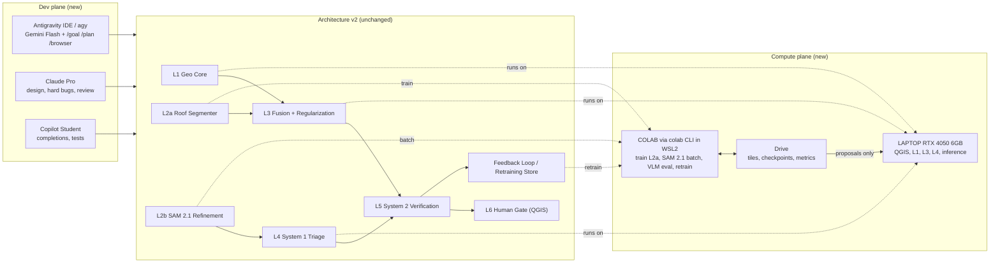

# Architecture v2 + development and compute plane (additive)

This page **adds** a dev/compute plane next to `perplexity AI/png/fig1_architecture_v2_hybrid.png`.
The original diagram and its layers L1-L6 are unchanged; the IDs below are the same ones.
Process details: [HYBRID_DEV_WORKFLOW.md](HYBRID_DEV_WORKFLOW.md).

New deployment tag: **`COLAB`** (next to the existing `WS`, `LAPTOP`, `CLOUD`, `LOCAL`).

## Layer to compute mapping

| Layer | Compute tag | Heavy job card |
|---|---|---|
| L1 | WS + LAPTOP | optional bulk tiling (not scaffolded yet) |
| L2a | **COLAB** (train) / LAPTOP (infer) | `compute/colab/jobs/train_l2a.yaml` |
| L2b | **COLAB** (batch) / LAPTOP (interactive) | `compute/colab/jobs/refine_sam21.yaml` |
| L5 | CLOUD + WS fallback | `compute/colab/jobs/vlm_eval.yaml` (evaluation only) |
| Feedback Loop | **COLAB** (retrain) | `compute/colab/jobs/retrain_from_feedback.yaml` |

Guarantees kept from v2: L3 geometry stays deterministic and local; L5 stays fail-closed; the
human gate (L6) is the only approval. Colab output never auto-approves anything.
