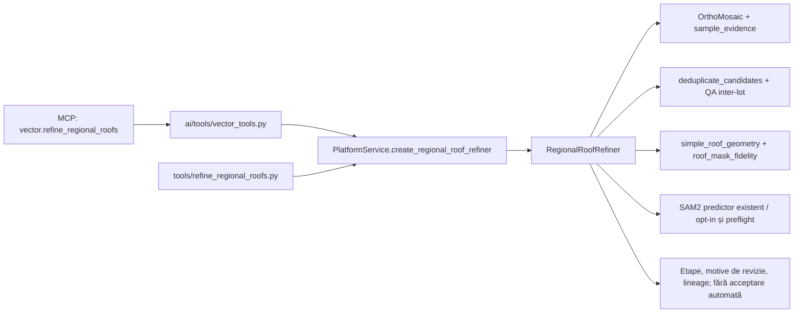

# StratumRO: rafinarea B, etape executate și predare

Data: 2026-10-18. Cerința proprietarului: implementarea rafinării B în proiectul comun, etape vizibile, cercetare pe surse prudente și checkpointuri Git. Planul este în [PLAN.md](PLAN.md), checkpoint `98be3e9`. Implementarea inițială este `f0d44b4`; integrarea suplimentară pentru agenți și prezentarea sunt în checkpointul următor acestei predări.

**Rezultat: flux executabil în StratumRO, 216 propuneri procesate și păstrate, 81 ipoteze trec porțile automate, 135 rămân în revizie. Nu sunt 81 clădiri validate.** Conflictele interne peste 0,05 m² au scăzut de la 107 la 68; cele 68 rămân explicite. Nu se pretinde inventar complet, acuratețe, recall sau validare cadastrală.

## Unde se vede

- Raportul vizual este deschis în browserul aplicației: `http://127.0.0.1:8767/index.html`. Server local, legat numai la `127.0.0.1`; nu publică date pe internet.
- Documentul persistă și fără server în `workspace/reviews/option_b_refinement_20261018_final/index.html`, împreună cu imaginile. Include **216 comparații înainte/după**, șase planșe cu etape și motive pentru fiecare caz.
- Proiect comun: `workspace/reviews/body_recovery_20261013/inspectie_corectii.qgs`. Grup: **`B_RAFINARE_20261018 - ETAPE SI REVIZIE`**. Straturile istorice sunt păstrate; cele două straturi B vechi au fost ascunse pentru a evita suprapunerea lor cu noua afișare.
- Cyan = ipoteză simplă; portocaliu = revizie. Niciuna dintre culori nu constituie acceptare a proprietarului. QA și coada celor 71 de candidați respinși anterior sunt straturi distincte.
- Au fost create șapte bookmarks pentru detalii. Proiectul live a fost salvat fără reîncărcare; înainte a fost păstrată copia byte-identică a versiunii anterioare de pe disc în `main_project_before_stages.qgs`. Starea live preexistentă a fost păstrată în proiect, nu resetată.

## Integrare reală, fără al doilea nucleu



- `stratum_ro/regional_refinement.py` este orchestrarea etapelor, nu un model nou sau o copie a nucleului. Reutilizează citirea, deduplicarea și fitterele existente.
- `simple_roof_geometry` primește limite opționale care se aplică tuturor propunerilor înainte de alegerea formei cu puține noduri. Impliciturile apelanților vechi sunt păstrate.
- `roof_mask_fidelity` poate păstra toate găurile și poate normaliza separat microgăuri cu suport local de înălțime, cu raportarea intervenției. Curțile, lipsa înălțimii și NoData nu furnizează dovezi pentru umplere.
- `PlatformService.create_regional_roof_refiner` expune același motor către CLI și către agenți.
- `vector.refine_regional_roofs` primește GeoJSON Features cu `candidate_id`, RGB autorizat în sandbox, înălțime opțională și alte obiecte existente. Returnează propuneri și diagnostice fără scrieri, inferență GPU ori modificări QGIS. Este înregistrat și testat într-o instanță de verificare a serverului. **Serverele MCP active nu au fost repornite**; conexiunile existente trebuie reîncărcate pentru descoperirea uneltei noi. [Dovada înregistrării](mcp_registration.json).
- Nu se afirmă că orice prompt arbitrar din aplicație a fost testat cap-coadă. CLI-ul și motorul comun au fost executate pe date reale; wrapperul agentului a fost verificat cu raster sintetic real, inclusiv sandbox și absența scrierilor.

## Etape și rezultate

| Etapă | Execuție și dovadă |
|---|---|
| 0. B inițial | 216 poligoane, fără schimbarea sursei istorice. `B0_BASELINE`. |
| 1. Proveniență și surse | Toate cele 216 au o potrivire geometrică peste pragul IoU 0,60 cu o observație regională. Acesta este un indiciu de proveniență, nu identitate semantică dovedită. `B1_OBSERVATIONS`. |
| 2. Identitate și deduplicare | Praguri prudente IoU 0,85 / containment 0,97; o componentă mică imbricată nu este eliminată doar pentru că e în interior. În rezultatul final nu s-a suprimat niciun ID. `B2_DEDUPLICATED`. |
| 3. Formă | Limite de dezvoltare: 0,50 m deplasare față de observația folosită, 4% arie, suport/acoperire 95%, maximum 24 noduri pentru ruta simplă. Formele fără susținere rămân observații în revizie. `B3_SIMPLE_FIT`. |
| 4. Rafinare SAM2 | Modelul Tiny local a fost rulat real pe patru propuneri, după trei selecții vizuale verificate: B006, B046 și B154/B169 pe aripa roșie comună. [Selecții](retry_selection.json), [preflight trecut](retry_preflight.json). |
| 5. QA după geometrie | 81 ipoteze simple, 135 în revizie; 68 perechi cu intersecție peste prag. Alte 28 intersecții cu loturile existente implică 25 de propuneri B. `B4_FINAL_REVIEW`, `UNRESOLVED_REVIEW`, `EXISTING_OTHER_LOTS`. |
| 6. Omisiuni și respingeri | Cei 71 respinși anterior sunt păstrați și li se recitesc statisticile, fără a-i declara adevărate fals pozitive. `B0_REJECTED_RECALL_QUEUE`. Nu s-a făcut o nouă detecție pe întregul AOI. |
| 7. Prezentare | Toate cele 216 imagini înainte/după sunt randate din QGIS. Șase exemple au câte șase panouri. Raportul a fost deschis și verificat în browser; o planșă a fost deschisă din legătura ei. |

Nu se folosesc acești parametri drept toleranțe legale. Curățarea microgăurilor schimbă explicit topologia măștii: maximum 2 m² pe gaură, înălțime locală ≥1,8 m și diferență mediană ≤0,75 m față de vecinătate, fără NoData. Această ipoteză este marcată pentru revizie. Distanța față de toate limitele brute poate crește prin eliminarea găurilor interioare; gardul de formă se raportează la observația normalizată, iar aria totală rămâne controlată. Un nDSM de 1 m nu dovedește absența unei mici curți sau a unui luminator.

Cele 81 de ipoteze au trecut criterii de formă, acoperire și conflicte verificate; **nu există un clasificator semantic validat care să demonstreze că toate sunt clădiri**. O formă simplă poate fi încă greșită. Cele 135 nu sunt șterse sau ascunse din raport.

## SAM2: ce s-a folosit efectiv

- B006: variantele noi nu au trecut pragul de scor; observația originală rămâne. Cazul corespunde și unui obiect dintr-un lot anterior, deci nu este promovat ca obiect nou.
- B046: mască nouă cu scor aproximativ 0,923; după curățarea microgăurilor susținute și simplificare, 458 noduri brute devin 21. A rămas în revizie, fără acceptare automată.
- B154: o variantă cu scor mare pierdea prea mult din observația originală; nu a fost promovată.
- B169: o variantă recupera o întindere mai mare, dar producea o mască mult prea complexă și cu multe goluri. Noua gardă de complexitate o păstrează diagnostic; rezultatul propus folosește observația anterioară simplificată, cu identitate/suprapunere încă nerezolvate.

Au fost păstrate **16 componente vectorizate ale celor 12 variante SAM2** (trei pe propunere), scorurile și motivele de respingere, în `SAM2_ALL_ATTEMPTS`. Vectorizarea păstrează componentele peste limita de arie a fluxului; nu pretindem că acest GPKG conține toate matricile binare dense ale modelului. Sursa reală a inferenței și checkpointul sunt legate în manifestul rulării `option_b_refinement_20261018_run4`. Rularea finală **reutilizează** aceste rezultate; nu este o a doua inferență.

## Descoperiri corectate

1. Scriptul vechi căuta `body_recovery_20261013/review18.gpkg` și straturi inexistente, apoi ignora erorile. Calea reală este `review18_20261013/review18.gpkg`; straturile și filtrele au fost confruntate cu QGIS. Loaderul reparat citește 48 de geometrii din loturile 1–4 și semnalează fișiere/straturi lipsă. Nu s-a rerulat scriptul vechi care ar suprascrie rezultatele istorice.
2. Rata de fals pozitive scrisă literal `0.0` este înlocuită în generator cu `None` și `NOT_MEASURED_NO_INDEPENDENT_LABELS`. Rapoartele istorice nu sunt rescrise. Comentariile nu mai prezintă pragurile fixe drept calibrare învățată sau loturile drept ground truth.
3. Rasterele puteau ascunde noile straturi în ordinea personalizată QGIS. Integrarea folosește `qgis_render_order.vectors_above_rasters` și pune grupul nou în ordinea de randare. Vizibilitatea a fost verificată după această corecție; numai existența grupului nu a fost considerată dovadă de afișare.

## Verificări

- Suita inițială a implementării: 502 teste, 493 trecute, 9 omise, [rezumat](tests.json), [log lizibil](full_suite_readable.txt).
- După integrarea uneltei pentru agenți: **503 teste, 494 trecute, 9 omise**, 38,149 s; [log](full_suite_with_agent_tool.txt). Cele 12 teste ale noului modul includ amprentă în L și curte, NoData și negru valid, lipsa clasei 6, recuperare peste limitele măștii vechi, conflicte fără unire/decupare, legarea la alt lot fără editarea lui și apelul real al wrapperului agentului. [Log vizat](agent_integration_tests.txt).
- Rulare finală: 216 intrări și ieșiri, 0 geometrii invalide la verificarea exportului, fără schimbarea verdictelor proprietarului. Verificarea numerică independentă a acestei etape este în `verification.json`.
- 216 hash-uri ale imaginilor verificate la generarea raportului. Randările separate nu au schimbat proiectul; grupul a fost adăugat ulterior printr-o operație explicită de integrare și salvare.
- QGIS și raportul din browser au fost verificate vizual pe detalii. Cele 216 imagini sunt disponibile; **nu pretindem o acceptare vizuală individuală exhaustivă a tuturor celor 216 de către agent**.

## Cercetare folosită prudent

Consultate surse primare/documentație oficială, fără instalări, scripturi descărcate sau încărcări de ortofoto în servicii externe:

- [Ji et al., 2024: LiDAR + indicii automate pentru SAM](https://mdpi-res.com/d_attachment/remotesensing/remotesensing-16-02661/article_deploy/remotesensing-16-02661.pdf): justifică experimentarea semințelor automate din evidență locală. Nu transferăm performanța la Cluj și nu tratăm SAM ca model semantic cadastral.
- [Schuegraf et al., 2024, POL](https://isprs-annals.copernicus.org/articles/X-2-2024/217/2024/): orientare și construcție de poligoane. Principiul este relevant, dar nu am implementat/antrenat modelul POL sau copiat timpii publicați.
- [SAMPolyBuild, repository-ul autorilor](https://github.com/wchh-2000/SAMPolyBuild): candidat de benchmark ulterior pentru muchii/vârfuri și mod automat. Nu a fost instalat, testat sau declarat superior local.
- [SAM2 oficial](https://github.com/facebookresearch/sam2): predictorul deja existent în proiect, fără schimbarea ponderilor.
- [Rasterio mask](https://rasterio.readthedocs.io/en/stable/api/rasterio.mask.html): păstrarea măștii de validitate, fără transformarea valorilor umplute în observații.
- [Shapely coverage_simplify](https://shapely.readthedocs.io/en/stable/reference/shapely.coverage_simplify.html): nepotrivit de aplicat direct B, deoarece premisa de acoperire fără suprapuneri nu este satisfăcută.

## Reproducere și Git

Rulare fără inferență:

```powershell
venv\Scripts\python.exe tools/refine_regional_roofs.py --config workspace/option_b_refinement_20261018/config.json --output workspace/reviews/<director-nou>
```

Rulare cu inferență reală pe selecțiile revizuite:

```powershell
venv\Scripts\python.exe tools/refine_regional_roofs.py --config workspace/option_b_refinement_20261018/config_with_retry.json --output workspace/reviews/<alt-director-nou>
```

Configurația `config_replay.json` reutilizează măștile reale păstrate. Niciun runner nu suprascrie un director existent. Corpusul sursă, masca de validitate, modelul și fișierele GIS locale sunt necesare; un clone Git nu este singur un pachet portabil complet.

Codul, testele, configurațiile, rapoartele numerice, documentația și manifestele sunt versionate local în Git. Datele GIS și capturile noi rămân locale în `workspace/reviews/`, conform cerinței explicite din conversația reconciliată. Nu au fost adoptate cele două unelte neversionate ale Antigravity sau modificarea preexistentă a GPKG-ului comparației. Proiectul QGIS comun a fost salvat, dar nu este inclus în commitul de cod deoarece conține și starea live preexistentă. Nu s-a făcut push sau merge; PR #4 rămâne draft.

Încercările locale `run2`–`run7` sunt păstrate. Prima încercare a fost oprită explicit pentru geometrie multipart, apoi s-a permis numai desfacerea exactă a unui MultiPolygon cu o singură parte, fără eliminarea componentelor. Variantele cu rezultate mai complexe și variantele cu suprimare nedorită rămân dovezi, fără a fi promovate în final.

## Ce rămâne înainte de automatizarea generală

Rezolvarea identității în cele 68 de perechi, tratarea celor 27 de cazuri cu acoperire optică incompletă și o evaluare semantică independentă a clădirilor găsite/omise. Un model specializat poate fi comparat ulterior pe aceeași zonă, cu etichete curate și holdout. Nu este justificată ascunderea acestor probleme printr-un prag mai permisiv, umplerea curților ori unirea automată a corpurilor.
