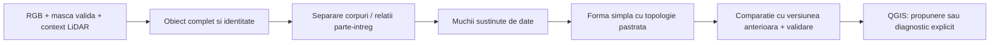

# Optiunea B: reverificare in QGIS si cercetare, 2026-10-19

**Concluzie:** noua reparatie B este mixta si nu justifica inlocuirea globala a rezultatului anterior. Nu este pregatita pentru livrare automata. Cele cinci loturi raman vizibile; vederea B anterioara ramane activa. Toate straturile B existente au contur mov `#b030e0`, inclusiv variantele noi ascunse. Vizibilitatea nu a fost schimbata prin aplicarea stilului. Nu s-a sters, retras, mutat in junk sau modificat niciun contur.

## Ce nu a mers

1. Au fost amestecate probleme diferite: identitatea obiectului, acoperirea intregului acoperis, clasificarea suprafetei si simplificarea geometrica. Simplificarea nu poate transforma un arbore, santier sau fragment intr-o cladire corecta.
2. Alegerea celui mai simplu candidat care trece praguri globale de masca/arie nu dovedeste potrivirea muchiilor. Ultimele garduri locale protejeaza unele retrageri, dar conserva si zgomotul ori decuparile false ale observatiei initiale. Protectia impotriva unghiurilor ascutite noi nu elimina automat varfurile gresite deja existente.
3. Pastrarea identitatilor a fost corecta, dar avertismentele parte-intreg nu au rezolvat duplicarea aceleiasi suprafete. Conturul complet si fragmentele lui raman uneori amestecate in propunerile de livrare.
4. Politica de afisare exclusiv B a ascuns loturile si a facut comparatia mai dificila. Aceasta a fost corectata in checkpointul anterior. Culorile comune cyan faceau mai greu de distins B de loturi; acum B este mov.
5. Raportarea nodurilor totale si a testelor software a fost insuficienta. Trebuia folosita o comparatie pe fiecare rezultat final in QGIS, inclusiv dupa revenirile impuse de gardurile vecinilor, fara a promova automat o varianta noua globala.

## Verificari executate, nu doar imagini

Audit prin QGIS 3.40: GEOS, validator intern QGIS, segmente, unghiuri, inele, intersectii si incluziuni. EPSG:3844, metri. Pragurile de 1 m, 40 grade, 12 noduri si 0,05 m² sunt semnale de dezvoltare; nu criterii legale sau dovezi ca orice forma semnalata este gresita.

| Verificare | B anterior, 216 | B nou, toate 216 | B nou, 152 propuneri |
|---|---:|---:|---:|
| Geometrii invalide GEOS | 0 | 0 | 0 |
| Cazuri cu mesaje validator intern QGIS | 8 | 8 | 0 |
| Perechi suprapuse peste 0,05 m² | 60 | 58 | 30 |
| Cazuri cu o muchie sub 1 m | 66 | 63 | 27 |
| Cazuri cu un unghi sub 40 grade | 24 | 14 | 5 |
| Cazuri cu peste 12 noduri | 47 | 52 | 18 |

Comparatia de 152 cu 216 nu este o imbunatatire masurata: 64 au fost separate ca diagnostice, nu reparate. In cele 30 perechi suprapuse ale propunerilor, 6 au incluziune peste 97% din aria obiectului mai mic. Sunt relatii de investigat, nu permisiune de unire sau stergere. Exemplu: B154/B169 se suprapun pe aproximativ 358,918 m²; B126/B174 pe aproximativ 263,552 m².

Cele 8 mesaje QGIS sunt noduri consecutive duplicate, aceleasi cazuri inainte/dupa: B182, B191, B194, B195, B197, B199, B201, B214. Sunt in stratul diagnostic. Nu inseamna ca GEOS a declarat aceleasi geometrii invalide.

54 geometrii sunt schimbate: 37 au mai multe noduri, 12 mai putine, 5 acelasi numar cu geometrie schimbata. Mai multe noduri pot fi necesare pentru o retragere reala, dar nu reprezinta automat progres. Complexitatea de peste 12 noduri a crescut cu 5 cazuri.

Citire proaspata a celor 216 cazuri din cele opt ortofotouri, la 15 cm, prin cititorul existent StratumRO, cu masca valida si nDSM: 25 contururi vechi si 26 noi ating NoData; cate un caz din fiecare varianta are sub 99,5% pixeli RGB valizi in poligon, si cate un caz are inaltime lipsa/partiala. **Un poligon cu pixeli valizi nu dovedeste acoperirea intregii cladiri**: daca segmentarea a pastrat numai fasia vizibila, validitatea pixelilor poate fi mare. Nu a fost masurat recall regional sau acuratete cadastrala.

Sursa B anterioara era deja modificata pe disc fata de Git. A fost pastrata separat si comparata cu copia Git: **zero geometrii diferite**, desi hash-urile fisierelor difera. Nu am inclus modificarile preexistente ale acelei surse in commitul sarcinii.

## Verificare vizuala in QGIS

Au fost inspectate 12 perechi de randari QGIS la acelasi cadru, cu sursele orto ale proiectului: B017, B035, B039, B043, B049, B068, B108, B126, B144, B152, B187, B210. Acesta este un esantion orientat spre probleme; auditul numeric acopera toate cele 216. Nu pretindem ca 216 obiecte au fost reverificate vizual individual in aceasta etapa.

- B039: conturul inca ocoleste un echipament de pe acoperis. Scaderea de la 22 la 7 noduri nu rezolva decuparea falsa.
- B108: geometrie finala neschimbata, varf suspect in zona partial mascata de vegetatie.
- B126: 68 la 58 noduri; zgomot exterior, goluri si obiecte continute raman.
- B144: proeminenta ascutita ramane, forma noua nu este suficienta.
- B187: fragment langa NoData; 4 la 18 noduri nu inseamna recuperare.
- B210: suprafata de santier/platforma, nu acoperis eligibil automat.
- B049: retragerea vizibila este mai bine pastrata. B035 pastreaza retragerea, dar alinierea superioara mai necesita verificare.
- B043: exterior mult mai curat. Un capat ascutit poate fi forma reala a acestui acoperis; nu trebuie eliminat numai pentru ca nu este dreptunghiular.
- B068: geometria finala este neschimbata, chiar daca existau alternative intermediare mai simple. Verificam intotdeauna rezultatul final exportat.
- B152: reducerea nodurilor nu rezolva singura marginea cu vegetatie si extremitatea ingusta a structurii oblice.

Observatii individuale si hash-uri: `qgis_visual_observations.json`. Imagini: `qgis_cases/*_comparison.jpg`. `main_overview.png` arata B mov alaturi de cele cinci loturi. `purple_B_with_five_lots.png` este cadrul de detaliu al canvasului la verificare, nu imaginea de ansamblu.

## Ce ar trebui implementat in continuare

Ordinea propusa porneste din constatarile locale si din cercetarea de mai jos. Aceste schimbari NU au fost implementate in acest audit.

1. **Unitatea completa si identitatea:** recitire cu context extins si vecini cand un rezultat atinge fereastra sau NoData; distinctie intre acoperis complet, corp, fragment si suprafata straina. Pentru imagine indisponibila, statut incomplet explicit. Fara desenarea unui dreptunghi prin zone necunoscute.
2. **Relatii intre candidati inainte de regularizare:** graf de vecinatate si incluziune, cu verificare RGB/inaltime. Rezolvarea candidatului complet versus parti si a corpurilor adiacente. Nu taiem si nu unim dupa aria suprapusa fara stabilirea identitatii.
3. **Muchii sprijinite de date:** ajustare robusta a segmentelor la muchiile RGB si, unde densitatea/alinierea permit, la limitele LiDAR. RANSAC si gruparea punctelor de muchie sunt candidati de evaluat; nDSM de 1 m singur nu garanteaza colturile la 15 cm. Lipsa clasei 6 nu respinge automat un acoperis.
4. **Simplificare cu obiectiv comun:** putine segmente lungi, colturi stabile, abatere fizica limitata si retrageri reale pastrate; directii oblice si curbe permise cand sunt observate. Modelele dreptunghi/L/U/T sunt ipoteze, nu forme obligatorii. Penalizarea muchiilor fara sprijin trebuie sa conteze, nu numai numarul nodurilor si acordul cu o masca deja gresita.
5. **Poarta de regresie per caz:** inainte de promovare, comparatie explicita cu rezultatul anterior pe aceeasi imagine, plus verificari de identitate, completitudine, muchii, noduri duplicate si conflicte. Un caz incert pastreaza alternativa anterioara pentru comparatie; nu promoveaza automat o observatie bruta mai zgomotoasa. Nicio promovare globala doar pentru un total de noduri mai mic.
6. **Evaluare curata:** esantion de referinta verificat pentru acoperisuri, separat de amprente la sol/GMW mixt, cu zone de evaluare independente. Masurare separata a detectiei obiectelor, completitudinii, erorii de contur si timpului real de corectie. Suprafetele necunoscute nu devin negative de antrenare. Un model semantic ulterior poate ajuta la falsuri, dar nu inlocuieste citirea corecta si topologia.

## Cercetare: ce sustine si ce nu sustine

- [Zhao, Kamran, Sohn, ISPRS 2020](https://isprs-annals.copernicus.org/articles/V-2-2020/617/2020/): studiaza impreuna detectia instantei si regularizarea prin reprezentarea geometrica a frontierei. Sustine investigarea unei legaturi intre identitate si contur; nu dovedeste ca modelul lor este deja compatibil sau mai bun pe datele noastre.
- [Widyaningrum et al., ISPRS 2018](https://isprs-archives.copernicus.org/articles/XLII-2/1199/2018/index.html): foloseste segmente de acoperis LiDAR, concave hull, preselectie RANSAC si grupare DBSCAN pentru muchii. Propunerea de a testa ajustarea robusta a liniilor vine din aceasta lucrare. Nu transferam rezultatele lor numerice asupra StratumRO.
- [Gui et al., ISPRS 2024, contributii DLR/Ohio State](https://isprs-annals.copernicus.org/articles/X-2-2024/81/2024/): trateaza consistent frontierele comune dintre unitati segmentate. Relevanta pentru corpurile alipite, cu o alta problema/sursa de date decat simplificarea actuala.
- [Documentatia oficiala Shapely: coverage_is_valid](https://shapely.readthedocs.io/en/2.1.2/reference/shapely.coverage_is_valid.html): o coverage valida presupune muchii potrivite si lipsa suprapunerilor. Spatiile intre cladiri sunt normale; nu trebuie umplute ca sa obtinem o coverage. Nici validitatea unui singur poligon, nici coverage_simplify nu demonstreaza identitatea sau corectitudinea semantica.

## Dovezi si reproducere

`live_validation.py` ruleaza prin bridge-ul QGIS existent. Pastreaza snapshotul initial chiar dupa o reluare, schimba numai stilurile si citeste geometriile. `sensor_validation.py` ruleaza cu Python din venv si cititorul existent. `build_evidence.py` conserva sursa observata si compara geometria cu copia din Git. `package_validation.py` exporta 432 inregistrari diagnostice in GPKG, observatiile si manifestul. Nu se suprascrie un export diagnostic existent.

Snapshoturile QGS trebuie restaurate la calea proiectului comun pentru rezolvarea corecta a surselor relative. Nu sunt proiecte autonome noi. Rezultatele, QML, JSON, imagini, GIS si codul auditului sunt versionate impreuna. Sursele orto/nDSM brute raman dependinte locale. Nu au fost pornite SAM2, antrenare, inferenta GPU sau teste concurente costisitoare.

Integratorul existent `tools/show_simple_roof_variations_qgis.py` are acum mov ca stil B si pastreaza implicit vizibilitatea celorlalte straturi. Acest comportament viitor a fost inspectat si verificat sintactic; integrarea unui grup nou nu a fost rerulata in proiect. Stilul real al straturilor existente a fost verificat live si prin randare. Algoritmul de geometrie nu s-a schimbat.

Copiile noii surse GPKG, inaintea checkpointului Git si observata dupa citirea QGIS, au aceleasi randuri in toate tabelele SQLite (`new_source_table_comparison.json` este lista goala), desi bytes/hash pot diferi din organizarea interna a bazei. Sunt pastrate ambele; nu s-a resetat sau adoptat modificarea binara a sursei active.
