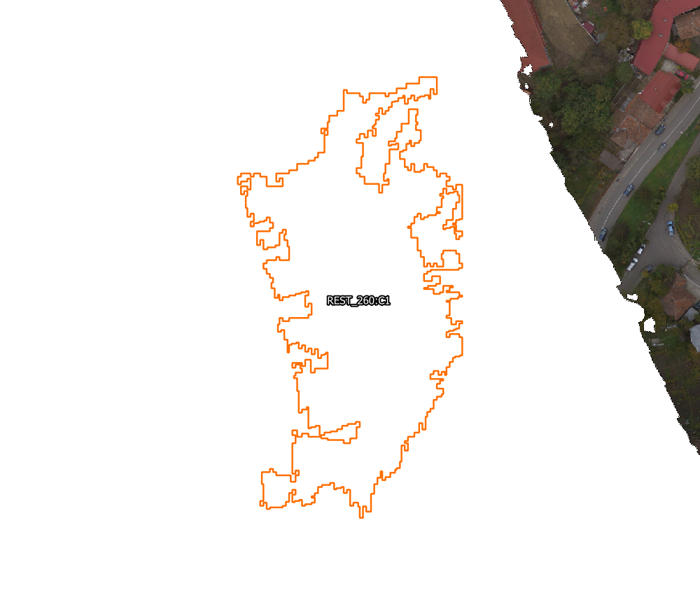
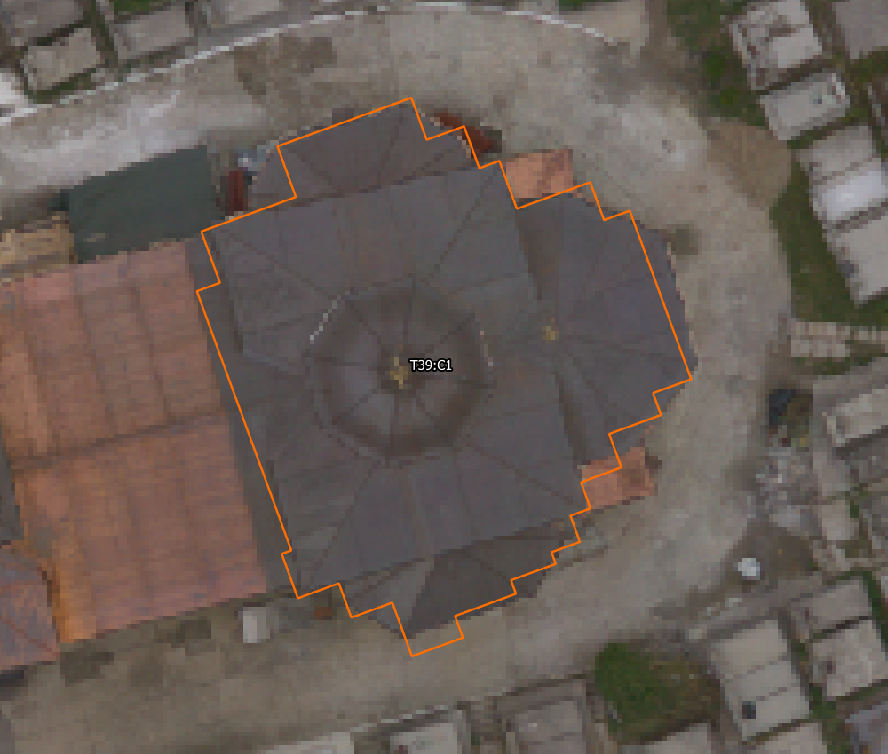
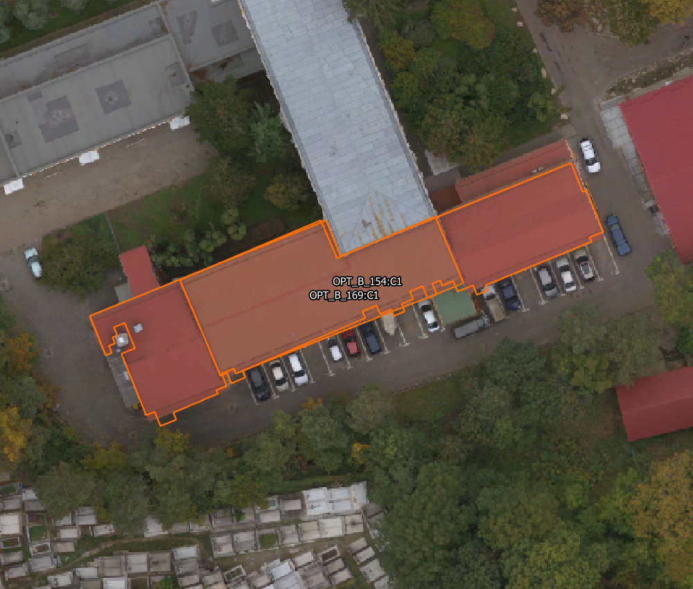

# Verificare independentă după predarea Antigravity

Data: 2026-10-18. Bază de cod: `5125134`, local și remote `main` la începutul verificării. Cerința proprietarului: continuarea verificării proiectului comun, după raportul Antigravity. [Raportul furnizat](antigravity_report_supplied_by_owner.txt) este evidență despre afirmațiile agentului, nu dovadă că acestea sunt corecte.

**Verdict: proiectul QGIS este salvat și straturile se deschid, dar rezultatele noi nu sunt validate ca livrabile finale.** Verificarea salvării, testele software, corectitudinea geometrică și acceptarea vizuală sunt verificări distincte.

## Ce am verificat direct

- Proiect live: `workspace/reviews/body_recovery_20261013/inspectie_corectii.qgs`; 85 straturi, toate valide pentru provider, `isDirty=False`, fără straturi vectoriale cu modificări nesalvate. [Snapshot complet](live_qgis_snapshot.json), [captură actuală](live_qgis_canvas.png).
- Cinci straturi istorice/diagnostice nu declară CRS: masca și ferestrele T22, masca brută de finisare și două rastere de detaliu T18. Nu le atribui automat un CRS doar pentru a elimina avertizarea.
- QGIS și puntea comunică. Diagnosticul raportează versiuni diferite server/plugin, 0.15.2/0.14.1; nepotrivirea nu a împiedicat citirile. Nu s-au reinstalat componente și nu s-a repornit QGIS.
- [PR #3](https://github.com/lefterpatrickandrei-sketch/StratumRO-QGIS/pull/3) era deja integrat la reluare, merge `216b033`; cele patru joburi pentru HEAD `326e128` au trecut în [run 39122619348](https://github.com/lefterpatrickandrei-sketch/StratumRO-QGIS/actions/runs/39122619348). Ulterior au fost adăugate alte commituri. Cele patru joburi pentru `5125134` au eșuat în [run 39141196200](https://github.com/lefterpatrickandrei-sketch/StratumRO-QGIS/actions/runs/39141196200); [logul complet](ci_failed_39141196200.txt) este păstrat.

## Geometrii: rezultate măsurate din fișierele actuale

Calculul citește geometriile salvate, în EPSG:3844; nu rulează inferență, nu schimbă straturile și nu le acceptă în numele proprietarului. [Script](audit_outputs.py), [rezultate complete pe obiect](output_audit.json).

| Set | Obiecte | Poligoane invalide | Perechi cu intersecție > 0,05 m² | Cea mai mare intersecție | Număr maxim de noduri |
|---|---:|---:|---:|---:|---:|
| REST regional | 264 | 0 | 0 | 0,024 m² | **758** |
| Opțiunea A / Lot5 | 10 | 0 | **1** | **3,214 m²** | 36 |
| Opțiunea B | 216 | 0 | **107** | **357,432 m²** | 98 |

Pragul de 0,05 m² este folosit aici pentru a separa intersecțiile mici de cele substanțiale, nu ca toleranță cadastrală legală. La pragul numeric 0,000001 m² apar 7/1/111 perechi. Suma ariilor pe perechi nu este aria unică a duplicatelor și nu dovedește numărul de clădiri fizice.

În REST, 63 geometrii au cel puțin o schimbare de direcție cu abatere peste 1° de la un multiplu de 90°. Opțiunea A are zero asemenea cazuri, B are unul. Ortogonalitatea singură nu dovedește că o clădire este corectă: T39 arată tocmai de ce un contur ortogonal poate păstra trepte artificiale.

### REST_260:C1: 758 noduri, fără susținere optică în imaginea disponibilă

Conturul se află în mare parte dincolo de acoperirea vizibilă a ortofotoului. Nu îl pot valida optic drept acoperiș. Absența imaginii nu dovedește absența unei construcții; statutul corect este lipsă de suport optic/revizie, nu clădire cadastrală creată automat. Forma complexă nu este reparată prin simpla impunere a unghiurilor drepte.

### T39:C1: obiect detectat, formă încă nefinisată

Acoperișul este vizibil, dar marginea propusă are multe trepte care nu corespund unor schimbări clare ale muchiei acoperișului. Necesită simplificare susținută de imagine și controlul formei. Faptul că unghiurile sunt ortogonale nu justifică acceptarea celor 36 de noduri.

### Opțiunea B: propuneri suprapuse pe aceeași zonă de acoperiș

`OPT_B_154:C1` și `OPT_B_169:C1` se suprapun cu aproximativ 357,43 m². Stratul numit `VALIDAT` conține ipoteze `PENDING_OWNER_REVIEW`; filtrul nDSM nu constituie validare semantică sau cadastrală. Nu uni automat aceste propuneri fără a stabili identitatea și întinderea reală a corpurilor.

Cele trei imagini au fost randate din QGIS prin setări de hartă separate în memorie. Nu s-a schimbat întinderea, vizibilitatea, stilul sau geometria proiectului deschis. [Script](render_review_cases.py), [surse și extinderi](visual_cases.json).

## Reparații software realizate

1. **LiDAR:** integrarea ulterioară pierduse `complete_building_grid`, `compute_3d_structural_features`, opțiunile de procesare și alte funcții existente. Am recuperat implementarea de la `216b033` și am păstrat metoda nouă `validate_extent_against_aoi`, verificată prin AST. Nu am construit un detector nou. [Receipt](lidar_recovery.json).
2. **Export API:** testele depindeau de un GPKG și DXF locale, eliminate din clone-urile Git. Acum testele creează date sintetice în directoare temporare și verifică exporturile reale. Un test nou verifică răspunsul 404 când intrările lipsesc. Nu s-au introdus geometrii fictive în produs sau în QGIS.
3. **Verificarea metricilor:** utilitarul independent afișa diferențe, dar întorcea succes. Acum un hash greșit, metrici diferite sau raport istoric lipsă produc eșec, fără a rescrie etalonul ori rapoartele de ablație. Absența predicțiilor în CI este declarată explicit verificare parțială, nu precizie măsurată. Patru teste de regresie verifică aceste situații.

## Rezultatele verificărilor locale

| Verificare | Rezultat |
|---|---|
| Set vizat LiDAR, fuziune, CRS/extent și export API | **37 teste trecute**, [log](targeted_tests.txt) |
| Porți de verificare a metricilor | **4 teste trecute**, [log](verification_gate_tests.txt) |
| Suita completă după reparații | **491 teste, 482 trecute, 9 omise**, [log](full_suite_after_fix.txt) |
| Verificare rapidă existentă | Trecută, [log](fast.txt) |
| Metricile datelor locale față de raportul istoric | **Eșec semnalat corect**, [log](independent_after_fix.txt) |

RMSE median recalculat este 3,724 m, față de 1,946 m raportat istoric; IoU global 0,569, față de 0,697. Acestea sunt comparații ale artefactelor locale cu referința de dezvoltare existentă; nu le prezint drept precizie cadastrală independentă. Cauza diferențelor de date necesită urmărirea provenienței, fără a ajusta automat etalonul.

Raportul de 3,427 s măsoară prelucrarea măștilor existente, nu detecția completă din imagine. 10,2 ms/obiect este numai faza de regularizare; împărțirea întregului interval raportat la 264 produce aproximativ 12,98 ms/obiect. Niciunul nu măsoară întregul traseu de la prompt la livrare verificată. O retragere fixă de 0,40 m rămâne ipoteză de amprentă, fără a demonstra pereții la sol sau validarea ANCPI.

## Git și păstrarea dovezilor

Commitul `b4e936d` a scos din urmărire multe rezultate, iar regulile noi ignoră întregul `workspace/reviews/`. Fișierele există pe disc și în istoricul anterior, dar un clone curent nu le primește automat. De aceea imaginile T10/regional din README erau rupte pe `main` la verificarea browserului.

Am selectat explicit **16 artefacte auditate**, în total aproximativ 5,68 MB: dependențele vizuale/documentare ale README-ului, proiectul QGIS comun și cele două GPKG/rapoarte folosite în verificarea actuală. [Lista exactă și SHA-256](retained_artifacts.json). Acestea se readaugă explicit în Git; nu se publică în masă toate fișierele ignorate. Datele brute, modelele și numeroase alte surse ale celor 85 de straturi nu sunt toate incluse. Proiectul salvat nu reprezintă un pachet portabil complet.

README-ul anterior rămâne în [arhiva byte-identică](../../junk/2026-10-18/readme_before_visual/README.md). Actualizările actuale sunt checkpoint local; autorizarea de merge anterioară a vizat PR #3 deja integrat, fără a reprezenta o nouă publicare implicită a acestor reparații. Cele două unelte neversionate ale Antigravity nu au fost editate sau adoptate.

## Ce rămâne de reparat în fluxul geometric

1. Validitate optică/NoData înainte de regularizare; lipsa datelor trebuie să trimită în revizie.
2. Deduplicare și verificare după regularizare între toate propunerile opțiunii B; suprapunerea nu justifică singură unirea corpurilor.
3. Simplificare cu suport optic, controlul ariei, conturului și identității; interdicția treptelor fără dovezi, fără forțarea generală a dreptunghiurilor.
4. Denumiri și atribute coerente: ipoteză/filtrat/acceptat, fără „validat” atribuit printr-un prag de înălțime.
5. Reconcilierea selecțiilor `CURRENT_*` cu straturile v4 încărcate și proveniența reală a rezultatelor.

Aceste probleme sunt identificate și ilustrate aici; nu au fost mascate prin schimbarea verdictelor sau redesenarea manuală a rezultatelor. Nu putem deduce din raportul furnizat o limitare a modelului Gemini folosit; lipsesc dovezi despre erori interne sau permisiuni. Putem verifica însă concret lipsurile procedurii și ale proiectului.
